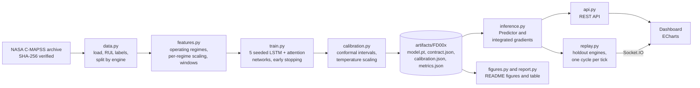

# Turbofan remaining-useful-life prediction, with calibrated uncertainty and explanations

[](https://github.com/easensoy/ml-predictive-maintenance-system/actions/workflows/ci.yml)


How many cycles does this engine have left, how sure is the model, and why? This project
answers all three on NASA's **C-MAPSS** run-to-failure benchmark, and shows them in a live
dashboard that replays engines the model never saw during training.

<picture>
  <source media="(prefers-color-scheme: dark)" srcset="predictive-maintenance/docs/figures/dashboard-dark.png">
  
</picture>

## What it does

- **Remaining useful life (RUL)** for each engine, with a **90% interval** whose coverage is
  calibrated by split-conformal prediction (conformalized quantile regression).
- **Probability of failure within 30 cycles**, temperature-scaled so that "70%" means roughly 70%.
  It drives three states: Healthy, Watch (failure within 30 cycles is inside the interval) and
  Alert (more likely than not).
- **An explanation for every prediction**: integrated gradients attribute the predicted RUL to
  each sensor reading in the model's input window, measured in cycles.
- **A live replay**: held-out engines stream cycle by cycle over Socket.IO and the model runs on
  each new cycle, as it would in a streaming deployment.

Every number on this page and in the dashboard is read from the training run's
`metrics.json`. Nothing is typed in by hand.

## Results

Evaluated once on NASA's official test sets: one prediction per engine, at its last recorded
cycle. RMSE and the PHM08 score use ground truth capped at 125 cycles, like the training target;
uncapped values are in each `metrics.json`. Lead time is measured on holdout engines that run to
failure.

<!-- results:start -->
| Subset | Window | Test engines | RMSE | PHM08 score | RMSE, uncapped truth | Inside 90% interval | Alert PR-AUC | Median alert lead time | Single LSTM RMSE | LightGBM RMSE |
|---|---:|---:|---:|---:|---:|---:|---:|---:|---:|---:|
| FD001 | 60 | 100 | **12.89** | 249 | 14.32 | 86% (±16 cycles) | 0.985 | 27 cycles (0/15 missed) | 13.44 ± 0.62 (n=5) | 12.52 |
| FD002 | 60 | 259 | **12.48** | 711 | 25.36 | 91% (±16 cycles) | 0.996 | 31 cycles (0/39 missed) | 13.05 ± 0.41 (n=5) | 11.54 |
| FD003 | 50 | 100 | **13.19** | 645 | 14.92 | 83% (±14 cycles) | 0.998 | 29 cycles (0/15 missed) | 13.76 ± 0.37 (n=5) | 12.47 |
| FD004 | 50 | 248 | **13.06** | 764 | 25.84 | 82% (±15 cycles) | 0.981 | 32 cycles (0/37 missed) | 13.78 ± 0.41 (n=5) | 13.48 |
<!-- results:end -->

The deep model is an ensemble of five independently seeded networks. "Single LSTM" is the mean
and standard deviation of those five members on their own. LightGBM is a gradient-boosting
baseline trained on the same windows, summarised as last value, mean, standard deviation and
slope for each sensor.

**An honest reading.** On point accuracy alone, the LightGBM baseline matches the network: it is
slightly better on FD001 to FD003 and worse on FD004. Simple window statistics are known to be
strong on C-MAPSS. What the network adds is a single model that also gives a calibrated interval,
an alert probability and a per-reading explanation. The uncapped RMSE is much higher on FD002 and
FD004 because some of their test engines have up to 195 cycles left, far beyond the 125-cycle cap.

<picture>
  <source media="(prefers-color-scheme: dark)" srcset="predictive-maintenance/docs/figures/results-dark.png">
  
</picture>

<picture>
  <source media="(prefers-color-scheme: dark)" srcset="predictive-maintenance/docs/figures/test-sets-dark.png">
  
</picture>

<picture>
  <source media="(prefers-color-scheme: dark)" srcset="predictive-maintenance/docs/figures/holdout-lives-dark.png">
  
</picture>

<picture>
  <source media="(prefers-color-scheme: dark)" srcset="predictive-maintenance/docs/figures/attribution-dark.png">
  
</picture>

<picture>
  <source media="(prefers-color-scheme: dark)" srcset="predictive-maintenance/docs/figures/alerts-dark.png">
  
</picture>

### Published results for context

RMSE as reported in Table 4 of Chaoub et al. (2021); HDNN's FD001 value of 13.017 is rounded
here. These are context, not a leaderboard. Those
studies train on all of the training engines, while this project holds 30% back for calibration and
lead-time analysis, and window lengths and RUL caps differ between papers.

| Method | FD001 | FD002 | FD003 | FD004 |
|---|---:|---:|---:|---:|
| MS-DCNN, Li et al. (2020) | 11.44 | 19.35 | 11.67 | 22.22 |
| DA-CNN, Song et al. (2020) | 11.78 | 16.95 | 11.56 | 18.23 |
| HDNN, Al-Dulaimi et al. (2019) | 13.02 | 15.24 | 12.22 | 18.15 |
| MLP-LSTM-MLP, Chaoub et al. (2021) | 13.26 | 12.49 | 13.11 | 13.97 |

## How it works



**Protocol.**
- Training engines are split **by engine** into train (70%), validation (15%) and holdout
  (15%), so no engine ever contributes windows to two splits.
- Sensor scaling is fitted on the train split only. FD002 and FD004 mix six flight conditions, so
  readings are clustered into operating regimes and each regime is scaled separately.
- The target is the usual piecewise-linear RUL, capped at 125 cycles.
- The input window length (30, 40, 50 or 60 cycles) is chosen for each subset by validation
  RMSE, with two seeds per candidate. The chosen length is recorded in `metrics.json`.
- Each ensemble member early-stops on validation RMSE. The conformal margin and the alert
  temperature are fitted on the validation engines.
- The official test set is scored once, at the end.

**One feature contract.** `features.py` turns raw readings into model windows, and it is saved
next to the model as `contract.json`. Training, the API and the replay all use this one code path,
and a test checks that a served window equals the training window for the same cycles. (Version 1
of this project broke exactly there; see [History](#history).)

**Model.** A 2-layer LSTM with attention pooling feeds two heads. The first predicts the RUL point
estimate (MSE loss) and its 5th and 95th percentiles (pinball loss), with the bounds placed on
either side of the point by construction so they cannot cross. The second predicts the logit of
failure within 30 cycles. Each output is averaged over 5 seeds.

## Quick start

Requires [uv](https://docs.astral.sh/uv/) (tested with 0.13.7) and Python 3.15, which uv can install.

```bash
cd predictive-maintenance
uv sync                                    # installs dependencies (CPU PyTorch)
uv run python -m predmaint.data download   # 12 MB from NASA, checksum-verified
uv run python -m predmaint.serve           # dashboard on http://127.0.0.1:5000
```

The trained FD001 model ships in `artifacts/FD001`, so the dashboard works straight away. To
reproduce the results:

```bash
uv run python -m predmaint.train --subset FD001 --window 60   # see metrics.json for each subset's window
uv run python -m predmaint.figures                            # rebuild docs/figures
uv run python -m predmaint.report                             # rewrite the results table above
uv run pytest                                                 # tests use a synthetic dataset, no download
```

The published artifacts were trained on a laptop GPU (NVIDIA RTX 1000 Ada) with the CUDA build of
PyTorch 2.15 and `--device cuda`, which takes about a minute per network on FD001. The locked
environment installs CPU PyTorch, which runs the same pipeline about ten times slower; install a
CUDA build from [pytorch.org](https://pytorch.org) to use a GPU. Seeds are not bit-for-bit
reproducible across devices.

Or run it in Docker: gunicorn serves it as a non-root user, and the image includes a health check.

```bash
docker build -t predmaint predictive-maintenance
docker run --rm -p 8000:8000 predmaint             # http://localhost:8000
```

Settings come from `PM_*` environment variables and default to safe values: loopback host, debug
off, same-origin Socket.IO. The full list is in
[`config.py`](predictive-maintenance/src/predmaint/config.py).

## API

| Method | Path | Returns |
|---|---|---|
| GET | `/api/health` | `ok` only if a smoke inference succeeds, otherwise 503 |
| GET | `/api/model-info` | test metrics, baseline, calibration and provenance, from `metrics.json` |
| POST | `/api/predict` | RUL with interval, failure probability, status and per-sensor attribution |
| GET | `/api/fleet` | current state of every replayed engine |
| GET | `/api/engines/<unit>` | one engine's prediction history, attribution heatmap and sensor traces |

`/api/predict` takes raw cycles, oldest first: the three operational settings and the 14 sensors
the model uses (sensors 2, 3, 4, 7, 8, 9, 11, 12, 13, 14, 15, 17, 20 and 21). Extra keys are
ignored. Short histories are padded, and the response says so.

```bash
curl -s -X POST http://127.0.0.1:5000/api/predict \
     -H "Content-Type: application/json" \
     -d @predictive-maintenance/docs/example-request.json
```

## Project layout

```
predictive-maintenance/
├── src/predmaint/
│   ├── data.py          download, checksums, loading, RUL labels, engine-level split
│   ├── features.py      the feature contract shared by training and serving
│   ├── model.py         LSTM + attention, losses, integrated gradients
│   ├── calibration.py   conformal intervals, temperature scaling
│   ├── metrics.py       RMSE, PHM08 score, coverage, calibration error, lead time
│   ├── train.py         training CLI
│   ├── inference.py     Predictor: artifacts to calibrated, explained predictions
│   ├── replay.py        live fleet replay of holdout engines
│   ├── api.py           Flask + Socket.IO app; serve.py and wsgi.py run it
│   ├── figures.py       README figures (light and dark)
│   ├── report.py        README results table
│   ├── templates/, static/   the dashboard
├── tests/               58 tests on a synthetic dataset in the C-MAPSS file format
├── artifacts/FD001/     the shipped demo model and its metrics
├── docs/figures/        generated figures
├── Dockerfile
└── pyproject.toml, uv.lock
```

## Limitations

- **C-MAPSS is simulated.** It comes from NASA's turbofan simulator, not from field engines. It is
  the standard benchmark for this problem, but good numbers here do not prove field performance.
- **Window length was chosen on validation engines.** While comparing candidates during
  development, I also printed their test scores, so the test set is not perfectly untouched.
- **The 90% intervals fall short on some test sets.** The results table shows the real test
  coverage. The conformal guarantee assumes calibration samples are exchangeable, but the windows
  of one engine are strongly correlated and there are only 15 to 39 validation engines. On those
  engines the model's own 5–95% band covers more than 90%, so calibration narrows it, and on new
  engines that is sometimes too far. Cross-validated calibration over all training engines
  (CV+) is the obvious next step.
- **Training data is smaller than in the papers.** Holding out 30% of training engines buys a
  clean calibration set and a lead-time test, at the cost of training data.
- **Single-process demo.** The replay lives in process memory, so it runs with one gunicorn
  worker. The API is read-only, holds no user data and has no authentication.

## History

Version 1 of this repository (2025) described a "production-ready" system, but an audit in
November 2026 found that it did not hold up:

- Its data was synthetic.
- Its model could not serve a prediction.
- Its dashboard metrics were hard-coded.
- Its "live sensors" were random numbers.

Version 2 replaces it with the pipeline above. The old code remains in the git history.

## Data and references

- A. Saxena, K. Goebel, D. Simon and N. Eklund, "Damage Propagation Modeling for Aircraft Engine
  Run-to-Failure Simulation", *PHM08*, 2008. Dataset: NASA Prognostics Center of Excellence.
- A. Chaoub, A. Voisin, C. Cerisara and B. Iung, "Learning representations with end-to-end models
  for improved remaining useful life prognostics", arXiv:2104.05049, 2021 (Table 4).
- Y. Romano, E. Patterson and E. Candès, "Conformalized Quantile Regression", *NeurIPS*, 2019.
- C. Guo, G. Pleiss, Y. Sun and K. Q. Weinberger, "On Calibration of Modern Neural Networks",
  *ICML*, 2017.
- M. Sundararajan, A. Taly and Q. Yan, "Axiomatic Attribution for Deep Networks", *ICML*, 2017.
