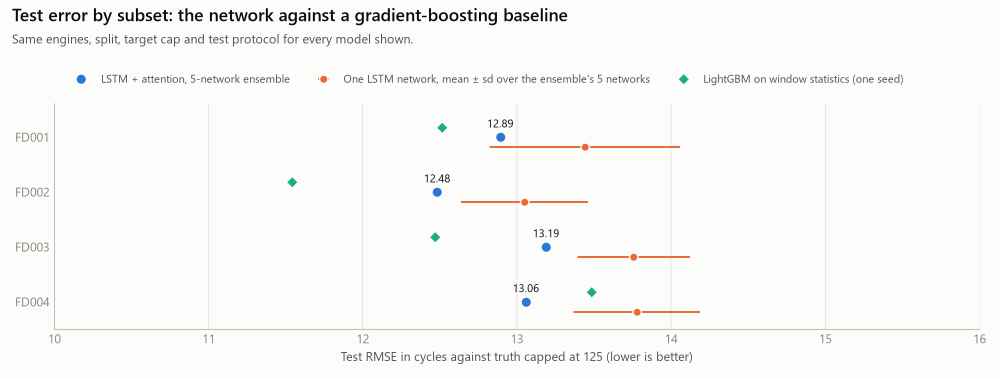
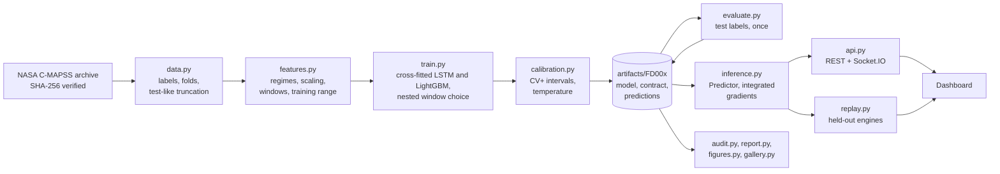

# Turbofan remaining-useful-life prediction with conformal intervals and alerts

[](https://github.com/easensoy/ml-predictive-maintenance-system/actions/workflows/ci.yml)

[](LICENSE)

How many cycles does this engine have left, how sure is the model, and when should it raise an
alert? This project answers those three questions on NASA's C-MAPSS run-to-failure benchmark.
It compares a five-network LSTM ensemble with a gradient-boosted baseline under one cross-fitted
protocol, and the official test sets were scored once, at the end.

**What the results support.**

<!-- summary:start -->
- **Accuracy.** LightGBM's test RMSE is lower on 3 of 4 subsets, and the paired difference is significant on 1 of 4.
- **Uncertainty.** Both models cover 94 to 96% of test engines with a nominal 90% interval, so the intervals are conservative rather than short. The LSTM's intervals are narrower on 4 of 4 subsets, by 5 to 35%, significantly on 4.
- **Alerting.** The alert ranks engines equally well for both models (alert AP 0.984 to 0.999) and first fires a median of 30 to 31 cycles before failure. The LSTM's alert switches off again 0.02 to 0.15 times per engine over a whole life; LightGBM's, 0.33 to 0.49 times.
<!-- summary:end -->

So on this benchmark the network is no more accurate than a gradient-boosted model on four
statistics per sensor, and on FD002 it is less accurate. What it adds is narrower intervals at
the same coverage, and an alert that switches itself off again far less often.

<picture>
  <source media="(prefers-color-scheme: dark)" srcset="predictive-maintenance/docs/figures/hero-dark.png">
  
</picture>

## Results

Every number on this page is generated from the committed artifacts by `python -m
predmaint.report`. `python -m predmaint.audit` recomputes each one from the per-engine
predictions, rebuilds the intervals from the networks' raw outputs, and fails if anything
differs. Three kinds of number appear, each labelled:

- **Test:** NASA's official test sets, one prediction per engine at its last recorded cycle,
  scored once by `predmaint.evaluate`.
- **Out of fold:** every cycle of every cross-fitted training engine, each predicted by the
  network that never saw it.
- **Replay:** the held-out engines the dashboard replays (in each `metrics.json`).

RMSE and the PHM08 score use the truth capped at 125 cycles, like the training target; "RMSE vs
actual RUL" uses NASA's uncapped truth.

<!-- results:start -->
**Official test sets.** Mean ± sd over 3 repeats of the whole pipeline; bold marks the better model in each subset. The coverage interval is a 95% Wilson interval over test engines at the mean rate. Width counts an open-ended interval up to the 125-cycle cap, so both models are measured on the same engines.

| Subset | Model | RMSE | PHM08 score | RMSE vs actual RUL | Inside the nominal 90% interval (95% CI) | Open-ended intervals | Mean interval width | Alert AP | Alert ECE |
|---|---|---:|---:|---:|---:|---:|---:|---:|---:|
| FD001 (100 engines) | LSTM ensemble | 12.94 ± 0.11 | 306 ± 17 | 14.28 ± 0.14 | 95.3 ± 0.6% (89–98%) | 45 ± 2% | 41.5 ± 1.4 cycles | 0.984 ± 0.004 | 0.045 ± 0.007 |
| FD001 (100 engines) | LightGBM | **12.11 ± 0.24** | **244 ± 3** | **13.36 ± 0.21** | 95.0 ± 1.0% (89–98%) | 39 ± 3% | 46.1 ± 2.7 cycles | **0.984 ± 0.002** | 0.044 ± 0.003 |
| FD002 (259 engines) | LSTM ensemble | 12.53 ± 0.11 | 643 ± 43 | 25.27 ± 0.37 | 96.4 ± 0.2% (94–98%) | 43 ± 2% | 39.7 ± 0.8 cycles | 0.996 ± 0.002 | 0.029 ± 0.000 |
| FD002 (259 engines) | LightGBM | **11.47 ± 0.10** | **571 ± 13** | **24.04 ± 0.08** | 95.6 ± 1.2% (93–98%) | 40 ± 4% | 41.6 ± 2.5 cycles | **0.999 ± 0.000** | 0.021 ± 0.002 |
| FD003 (100 engines) | LSTM ensemble | 13.22 ± 0.26 | 610 ± 55 | 14.90 ± 0.15 | 94.7 ± 3.1% (89–98%) | 42 ± 1% | 37.6 ± 2.9 cycles | **0.987 ± 0.001** | 0.031 ± 0.010 |
| FD003 (100 engines) | LightGBM | **12.03 ± 0.15** | **281 ± 12** | **13.63 ± 0.16** | 95.0 ± 3.0% (89–98%) | 57 ± 15% | 58.0 ± 11.3 cycles | 0.986 ± 0.006 | 0.031 ± 0.007 |
| FD004 (248 engines) | LSTM ensemble | **12.82 ± 0.29** | **737 ± 48** | 25.75 ± 0.06 | 95.8 ± 1.3% (93–98%) | 50 ± 0% | 43.1 ± 1.8 cycles | **0.985 ± 0.002** | 0.025 ± 0.004 |
| FD004 (248 engines) | LightGBM | 13.11 ± 0.15 | 905 ± 34 | **25.41 ± 0.11** | 94.2 ± 0.2% (91–97%) | 62 ± 5% | 56.0 ± 3.5 cycles | 0.984 ± 0.002 | 0.012 ± 0.004 |

**LSTM minus LightGBM on the same test engines.** Repeat-averaged difference, with a 95% interval from a paired bootstrap over test engines (2,000 draws). An interval that excludes 0 means the difference is larger than engine-to-engine noise.

| Subset | RMSE, LSTM minus LightGBM | PHM08 score, LSTM minus LightGBM | Coverage, LSTM minus LightGBM (points) | Interval width, LSTM minus LightGBM |
|---|---:|---:|---:|---:|
| FD001 | +0.83 (-0.70 to +2.39) | +62 (-22 to +180) | +0.3 (-2.3 to +3.0) | -4.6 (-7.7 to -1.8) |
| FD002 | +1.06 (+0.26 to +1.93) | +72 (-42 to +190) | +0.8 (-1.4 to +3.1) | -1.9 (-3.4 to -0.5) |
| FD003 | +1.19 (-0.50 to +3.25) | +329 (-53 to +1048) | -0.3 (-4.0 to +3.7) | -20.4 (-26.5 to -14.9) |
| FD004 | -0.30 (-1.04 to +0.46) | -168 (-438 to +14) | +1.6 (-0.9 to +4.2) | -12.9 (-16.0 to -10.1) |

**The alert over whole lives, out of fold.** Every cycle of every cross-fitted training engine, each predicted by a model that never saw it. Mean ± sd over repeats; the ECE interval is the repeat-averaged 95% bootstrap interval over engines.

| Subset | Model | Engines | First alert, median cycles before failure | Missed | First alert more than 30 cycles early | False-alert episodes per engine | Flaps per engine | ECE over all cycles (95% CI) |
|---|---|---:|---:|---:|---:|---:|---:|---:|
| FD001 | LSTM ensemble | 90 | 30 ± 1 | 0.0 ± 0.0 | 42.7 ± 3.2 | 0.48 ± 0.04 | 0.02 ± 0.01 | 0.008 ± 0.002 (0.006–0.013) |
| FD001 | LightGBM | 90 | 30 ± 0 | 0.0 ± 0.0 | 42.7 ± 1.5 | 0.61 ± 0.07 | 0.39 ± 0.06 | 0.005 ± 0.003 (0.004–0.009) |
| FD002 | LSTM ensemble | 234 | 30 ± 2 | 0.0 ± 0.0 | 111.3 ± 18.2 | 0.52 ± 0.10 | 0.15 ± 0.03 | 0.009 ± 0.003 (0.006–0.012) |
| FD002 | LightGBM | 234 | 30 ± 0 | 0.0 ± 0.0 | 110.3 ± 2.5 | 0.62 ± 0.04 | 0.36 ± 0.03 | 0.005 ± 0.001 (0.004–0.007) |
| FD003 | LSTM ensemble | 90 | 30 ± 1 | 0.0 ± 0.0 | 40.7 ± 6.7 | 0.47 ± 0.08 | 0.11 ± 0.02 | 0.008 ± 0.002 (0.005–0.012) |
| FD003 | LightGBM | 90 | 30 ± 0 | 0.0 ± 0.0 | 43.7 ± 1.5 | 0.61 ± 0.03 | 0.33 ± 0.06 | 0.004 ± 0.001 (0.003–0.007) |
| FD004 | LSTM ensemble | 224 | 31 ± 1 | 1.7 ± 1.5 | 110.0 ± 8.2 | 0.53 ± 0.05 | 0.12 ± 0.02 | 0.005 ± 0.001 (0.003–0.010) |
| FD004 | LightGBM | 224 | 30 ± 0 | 0.0 ± 0.0 | 105.7 ± 2.3 | 0.65 ± 0.01 | 0.49 ± 0.01 | 0.004 ± 0.001 (0.003–0.008) |
<!-- results:end -->

**How to read them.**

- **Coverage is above the nominal 90%.** Roughly half of the test engines are healthy enough
  that their interval reaches the cap and reads "at least N cycles" (the open-ended column).
  Engines close to failure get narrow intervals that rarely miss. The intervals are therefore
  conservative on these test sets, not tight.
- **Why the reading matters.** Read as a closed range ending at 125 cycles, as version 2 of this
  project did, the same intervals would miss every engine with more than 125 cycles left. The
  open-ended reading makes coverage of the capped truth and coverage of the actual remaining life
  the same number.
- **The early-alert column counts about half the engines for both models.** That is expected from
  a calibrated alert: the probability of failure within 30 cycles crosses 0.5 near 30 cycles
  before failure, so first alerts scatter on both sides of 30. Most early ones come within 10
  cycles of the horizon. The per-engine lead times are in each `metrics.json`.
- **Flaps measure how often the alert switches itself off again.** Over a whole life, a flapping
  alert is the one a maintenance team learns to ignore.

<picture>
  <source media="(prefers-color-scheme: dark)" srcset="predictive-maintenance/docs/figures/results-dark.png">
  
</picture>

<picture>
  <source media="(prefers-color-scheme: dark)" srcset="predictive-maintenance/docs/figures/test-sets-dark.png">
  
</picture>

<picture>
  <source media="(prefers-color-scheme: dark)" srcset="predictive-maintenance/docs/figures/alerts-dark.png">
  
</picture>

<picture>
  <source media="(prefers-color-scheme: dark)" srcset="predictive-maintenance/docs/figures/lives-dark.png">
  
</picture>

### Published results, and why they are not directly comparable

The RMSEs below are those listed in Table 4 of Chaoub et al. (2021), next to each study's
protocol. Only Chaoub et al.'s own paper could be read in full; the other three are paywalled, so
their protocol cells say "not checked" rather than guess. The studies differ in the RUL cap, the
engines used for training, the number of runs, the input and, above all, where on each test
trajectory the error is measured. The numbers therefore do not rank these methods against this
project, whose own numbers are in the tables above.

| Study | RUL cap | Training engines | Runs reported | Input | Test error measured at | FD001 | FD002 | FD003 | FD004 |
|---|---|---|---|---|---|---:|---:|---:|---:|
| This project | 125 | 90%, cross-fitted in 5 folds by engine; 10% held out for the replay | mean of 3 repeats of a 5-network ensemble | last 30–60 cycles, chosen per fold on inner-validation engines | last cycle of each test engine | see above | see above | see above | see above |
| MLP-LSTM-MLP, Chaoub et al. (2021) | 130 | 75% by engine, 25% for validation; retraining on all engines not stated | mean of 10 runs | whole trajectory, variable length | every cycle of each test trajectory (their Eq. 4) | 13.26 | 12.49 | 13.11 | 13.97 |
| MS-DCNN, Li et al. (2020) | not checked | not checked | not checked | not checked | not checked | 11.44 | 19.35 | 11.67 | 22.22 |
| DA-CNN, Song et al. (2021) | not checked | not checked | not checked | not checked | not checked | 11.78 | 16.95 | 11.56 | 18.23 |
| HDNN, Al-Dulaimi et al. (2019) | not checked | not checked | not checked | not checked | not checked | 13.02 | 15.24 | 12.22 | 18.15 |

Chaoub et al. report standard deviations over their 10 runs of 0.57, 0.28, 1.28 and 0.48
(Table 3). HDNN's FD001 value is 13.017 in their Table 4, rounded here; they cite the ICASSP 2019
version of HDNN. Chaoub et al. call the Song et al. model DA-CNN; its title calls it a
distributed-attention temporal convolutional network.

## Reproduce

Requires [uv](https://docs.astral.sh/uv/) (tested with 0.13.7) and Python 3.15, which uv can
install. Everything below runs from `predictive-maintenance/`.

Check the published numbers and rebuild the figures from the committed predictions, with no
download and no GPU:

```bash
uv sync
uv run python -m predmaint.audit     # recompute every table and interval; exit code 1 on a mismatch
uv run python -m predmaint.figures   # rebuild docs/figures from artifacts/
uv run pytest                        # synthetic-data tests, plus the audit of the committed artifacts
```

Run the dashboard on the shipped FD001 model:

```bash
uv run python -m predmaint.serve     # http://127.0.0.1:5000
```

Rerun the whole evaluation:

```bash
uv run python -m predmaint.data download          # 12 MB from NASA, checksum-verified
uv run python -m predmaint.train --subset FD001   # and FD002, FD003, FD004
uv run python -m predmaint.evaluate               # reads the test labels, once per run
uv run python -m predmaint.report                 # rewrite the generated blocks here and in the model card
uv run python -m predmaint.attribution_checks     # the attribution checks below
uv run python -m predmaint.gallery                # docs/failure-cases.md
uv run python -m predmaint.benchmark              # docs/benchmark.json
```

`predmaint.train` refuses to run from uncommitted sources, so every `metrics.json` names the
commit that produced it; `--allow-dirty` overrides that for experiments, and the ledger records
it. The published runs were trained on a laptop GPU (NVIDIA RTX 1000 Ada, CUDA build of PyTorch
2.15). The locked environment installs CPU PyTorch, which runs the same pipeline roughly ten
times slower, and GPU runs are not bit-for-bit reproducible across devices.

Docker serves the dashboard with gunicorn as a non-root user, with a health check:

```bash
docker build -t predmaint predictive-maintenance
docker run --rm -p 8000:8000 predmaint             # http://localhost:8000
```

## How it was evaluated

**Splits, all by engine.** For each subset, 10% of the training engines are set aside for the
dashboard replay: no network, scaler or calibration step ever sees them. The rest are split into
five folds, stratified by life length. For each fold, the other four folds are split again into
inner-train (85%) and inner-validation (15%) engines.

**Model selection.** For every fold, a network is trained for each candidate window (30, 40, 50
and 60 cycles) on inner-train and early-stopped on inner-validation RMSE, every engine weighted
equally; the window with the lowest inner-validation RMSE is kept. The architecture and
optimiser settings were fixed before this evaluation and not tuned. LightGBM gets the same folds,
inner splits and window choice, with separate models for the point, the 5th and 95th
percentiles, and the alert.

**Calibration, never on a selection engine.** Each fold's network predicts every cycle of the
engines in its fold. Each engine is then truncated once, at a length drawn from the official test
engines' trajectory lengths (sensor data only, never labels) among those shorter than its life,
so calibration points look like test points: one per engine, at a truncation point. Its
conformity score comes from the one network that never saw it, in training, early stopping or
window choice. These scores give CV+ intervals (cross-validated conformalized quantile
regression), nominally 90%; CV+ guarantees at least 80% for exchangeable engines and usually
gives close to 90%. The alert temperature is fitted the same way, on ten truncations per engine.
The alert fires when the calibrated probability of failure within 30 cycles reaches 0.5; that
threshold was fixed in advance and never tuned.

**The cap.** The target is RUL capped at 125 cycles. An interval whose upper end reaches the cap
is reported as open-ended, "at least the lower end", in the tables, the API and the dashboard.

**The test set, once.** Training never reads NASA's test labels. `predmaint.evaluate` reads them,
scores all three repeats of both models, and writes a "test viewed" entry to the
[experiment ledger](predictive-maintenance/docs/experiment-ledger.md) with its time and commit.
The earlier development runs, which did look at test scores, are listed there too.

**Repeats and comparisons.** The whole pipeline ran three times with different seeds (folds,
inner splits, initialisation, LightGBM sampling, truncation draws). Tables show mean ± sd over
repeats. Differences between the models use a paired bootstrap over test engines.

**Out-of-fold, replay and test numbers measure different things.** Test numbers use the five
networks of a repeat together, as served. Out-of-fold numbers use, for each engine, the one
network that did not see it, so they describe a single network over whole lives. The replay
engines are scored by the served ensemble but are few.

### Do the attributions mean anything?

Every prediction comes with integrated gradients: how much each reading in the input window moved
the predicted RUL, in cycles, compared with an average engine in the same operating regime.
`predmaint.attribution_checks` tests whether that is more than decoration.

<!-- attribution:start -->
On 40 windows from 10 FD001 replay engines (at 100, 60, 30, 10 cycles before failure), with the served five-network ensemble:

- **Completeness holds.** The attributions add up to the change in prediction to within 0.04 cycles (median), against a median change of 69 cycles.
- **They find readings the output depends on.** Removing readings in attribution order moves the prediction to the baseline far faster than random order: median deletion area 0.097 against 0.557 (lower is better), better in 32 of 40 windows.
- **But much of that is input deviation.** Ranking readings simply by how far they are from the baseline does almost as well (deletion area 0.132; attributions win in 26 of 40 windows, and in 18 of 40 on insertion).
- **The trained weights matter, moderately.** A randomly re-initialised network gives maps that rank-correlate 0.55 with the trained ones and delete less well (0.190).
- **The baseline matters.** Using each engine's own first cycles as the baseline instead of the regime average changes the maps (rank correlation 0.54; the top three sensors keep 2 of 3 in the median window).
<!-- attribution:end -->

So the attributions are faithful to the model's output and better than chance or an untrained
network, but they mostly highlight readings that are far from normal. Read them as "what the
prediction depends on", not as a diagnosis of the engine.

<picture>
  <source media="(prefers-color-scheme: dark)" srcset="predictive-maintenance/docs/figures/attribution-checks-dark.png">
  
</picture>

<picture>
  <source media="(prefers-color-scheme: dark)" srcset="predictive-maintenance/docs/figures/attribution-dark.png">
  
</picture>

### Where it fails

[`docs/failure-cases.md`](predictive-maintenance/docs/failure-cases.md) lists the worst interval
misses on the test sets and the earliest, latest and missed first alerts. It also breaks the
errors down by remaining life, observed trajectory length (short histories are padded) and
subset. It is generated by `python -m predmaint.gallery`. The pattern it shows:

- **Errors peak in mid-life.** The largest errors are for engines roughly 50 to 100 cycles from
  failure, where both models overestimate the remaining life. That is the dangerous direction.
- **Most of the worst misses are open-ended intervals.** They go to engines in that range that
  the model still read as healthy. The rest are the opposite error: engines predicted closer to
  failure than they were.
- **Alerts go wrong mainly on the six-condition subsets.** The only first alerts more than 60
  cycles before failure are on FD002 and FD004, and the only missed engines are the LSTM's, on
  FD004, which also has two fault modes.

### Latency

<!-- latency:start -->
Measured in process on an Intel Core Ultra 7 165H with 16 PyTorch threads, CPU only, for the served 5-network FD001 model:

| Operation | Median (p95) |
|---|---|
| Prediction | 11 ms (p95 13 ms) |
| Prediction with integrated gradients | 255 ms (p95 274 ms) |
| Replay tick, whole 10-engine fleet, no attributions | 61 ms (p95 64 ms) |
| Attribution refresh for one watched engine | 243 ms (p95 278 ms) |

The replay ticks every 1000 ms. At the 95th percentile, the fleet step plus 2 attribution refreshes takes 620 ms, and one more refresh would take it to 898 ms. So each tick refreshes at most `PM_EXPLAIN_PER_TICK` watched engines (2 by default), taking turns when more are watched.
<!-- latency:end -->
The numbers are in [`docs/benchmark.json`](predictive-maintenance/docs/benchmark.json).

## Architecture and API



**One feature contract.** `features.py` turns raw readings into model windows and is saved next
to the model as `contract.json`, with a format number and the training range of every feature.
Training, the API and the replay all use this one code path, and a test checks that a served
window equals the training window for the same cycles. The server refuses to start on a
contract, checkpoint or calibration file it cannot use, and says what to do.

**Model.** A 2-layer LSTM with attention pooling feeds two heads: the RUL point estimate (MSE)
with its 5th and 95th percentiles (pinball loss, kept on either side of the point by
construction), and the logit of failure within 30 cycles. Each of the five networks reads its own
window length; the served prediction averages them.

| Method | Path | Returns |
|---|---|---|
| GET | `/api/health` | `ok` only if a smoke inference succeeds, otherwise 503 |
| GET | `/api/model-info` | the served model's test metrics, windows, calibration and provenance |
| POST | `/api/predict` | RUL with its interval (open-ended at the cap), failure probability, status, attribution and an out-of-distribution report |
| GET | `/api/fleet` | current state of every replayed engine |
| GET | `/api/engines/<unit>` | one engine's prediction history, attribution heatmap and sensor traces |

`/api/predict` takes raw cycles, oldest first: the three operational settings and the 14 sensors
the model uses (2, 3, 4, 7, 8, 9, 11, 12, 13, 14, 15, 17, 20 and 21). Values must be finite JSON
numbers; short histories are padded, and the response says so. If any reading in the model's
window lies outside the training range, the response carries `"out_of_distribution": {"flag":
true, ...}` naming the sensors; if the network cannot give a finite answer at all, the API
returns 422 with the same report.

```bash
curl -s -X POST http://127.0.0.1:5000/api/predict \
     -H "Content-Type: application/json" \
     -d @predictive-maintenance/docs/example-request.json
```

Settings come from `PM_*` environment variables with safe defaults (loopback host, debug off,
same-origin Socket.IO); see [`config.py`](predictive-maintenance/src/predmaint/config.py). The
dashboard replays the held-out engines cycle by cycle; `?engine=<unit>` opens one of them, and
`&only=detail` shows just its panel:

<picture>
  <source media="(prefers-color-scheme: dark)" srcset="predictive-maintenance/docs/figures/dashboard-dark.png">
  
</picture>

## Limitations

- **C-MAPSS is simulated.** It comes from NASA's turbofan simulator, not from field engines. It
  is the standard benchmark for this problem, but good numbers here do not prove field
  performance.
- **The test sets were seen once before.** Version 2's development printed test scores (all
  in the ledger). The re-evaluation scored them once, but the architecture it inherited was
  chosen in that development.
- **The intervals are conservative, not tight.** They cover more than their nominal 90%. The
  calibration points match the test set's trajectory lengths, which needs no labels, but not its
  distribution of remaining life, which would.
- **The window grid may stop too early.** The longest candidate window, 60 cycles, won most
  folds, and on FD002 and FD004 inner-validation RMSE was still clearly falling at 60 for both
  models (see the [ledger](predictive-maintenance/docs/experiment-ledger.md)). Longer windows
  were not tried; they would also mean more padding for short test histories.
- **Out-of-fold numbers describe single networks.** The served ensemble averages five, so its
  whole-life behaviour can differ slightly.
- **The alert threshold is not tuned** to any cost of missed or false alerts.
- **The attributions mostly track input deviation** (see above).
- **Single-process demo.** The replay lives in process memory, so it runs with one gunicorn
  worker. The API is read-only, holds no user data and has no authentication.

The [model card](MODEL_CARD.md) covers intended use, out-of-scope uses and known failure modes.

## History

**Version 1 (2025)** described a "production-ready" system. An audit in November 2026 found that
its data was synthetic, its model could not serve a prediction, its dashboard metrics were
hard-coded and its "live sensors" were random numbers. Version 2 replaced it.

**Version 2 (6 November 2026)** rebuilt the project on C-MAPSS. An outside code review then
recomputed every published number from the committed predictions. All of them matched; the
problems were in the claims around them and in the calibration design:

- The conformal margin and alert temperature were fitted on the same validation engines that had
  chosen the window and stopped training, so the coverage guarantee claimed did not hold.
- Calibration pooled every overlapping window of those engines, while the test scores one point
  per engine.
- Intervals were clipped at the 125-cycle cap, so they could never contain an actual remaining
  life above it. Actual-RUL coverage was 60–78%, not the 82–91% shown.
- "Evaluated once" contradicted the README's own note that test scores were printed while
  windows were being chosen.
- The literature paragraph described protocols the papers do not use. Chaoub et al. cap at 130,
  split 75/25, average 10 runs and measure the error at every cycle, not the last one.
- The table bolded the network even on the three subsets where LightGBM was more accurate.
- The provenance recorded in `metrics.json` pointed at uncommitted code. A fresh clone could not
  rebuild the figures. A 401-digit JSON number crashed the API, and a NaN setting passed
  validation.

**Version 2.1 (8 November 2026)** is this repository. It fixed the claims first, then reran the
evaluation with the cross-fitted protocol above, and added the attribution checks, the failure
gallery, the latency budget and an audit that ties every published number to the committed
predictions. The old code and results remain in the git history.

## Data, licence and references

- Code: [MIT licence](LICENSE). To cite this software, use [CITATION.cff](CITATION.cff).
- Data: A. Saxena, K. Goebel, D. Simon and N. Eklund, "Damage Propagation Modeling for Aircraft
  Engine Run-to-Failure Simulation", *PHM08*, 2008,
  [doi:10.1109/PHM.2008.4711414](https://doi.org/10.1109/PHM.2008.4711414). Dataset: NASA
  Prognostics Center of Excellence. NASA does not specify a licence for it, so the raw files are
  not redistributed here; `predmaint.data download` fetches them. The rows this repository does
  contain are listed in the [model card](MODEL_CARD.md#data).
- R. F. Barber, E. J. Candès, A. Ramdas and R. J. Tibshirani, "Predictive inference with the
  jackknife+", *Annals of Statistics* 49(1), 2021 (CV+).
- Y. Romano, E. Patterson and E. Candès, "Conformalized Quantile Regression", *NeurIPS*, 2019.
- C. Guo, G. Pleiss, Y. Sun and K. Q. Weinberger, "On Calibration of Modern Neural Networks",
  *ICML*, 2017.
- M. Sundararajan, A. Taly and Q. Yan, "Axiomatic Attribution for Deep Networks", *ICML*, 2017.
- J. Adebayo, J. Gilmer, M. Muelly, I. Goodfellow, M. Hardt and B. Kim, "Sanity Checks for
  Saliency Maps", *NeurIPS*, 2018.
- A. Chaoub, A. Voisin, C. Cerisara and B. Iung, "Learning representations with end-to-end models
  for improved remaining useful life prognostics", arXiv:2104.05049, 2021.
- H. Li, W. Zhao, Y. Zhang and E. Zio, "Remaining useful life prediction using multi-scale deep
  convolutional neural network", *Applied Soft Computing* 89, 2020,
  [doi:10.1016/j.asoc.2020.106113](https://doi.org/10.1016/j.asoc.2020.106113).
- Y. Song, S. Gao, Y. Li, L. Jia, Q. Li and F. Pang, "Distributed attention-based temporal
  convolutional network for remaining useful life prediction", *IEEE Internet of Things Journal*
  8(12), 2021, [doi:10.1109/JIOT.2020.3004452](https://doi.org/10.1109/JIOT.2020.3004452).
- A. Al-Dulaimi, S. Zabihi, A. Asif and A. Mohammadi, "Hybrid deep neural network model for
  remaining useful life estimation", *ICASSP*, 2019,
  [doi:10.1109/ICASSP.2019.8683763](https://doi.org/10.1109/ICASSP.2019.8683763).
