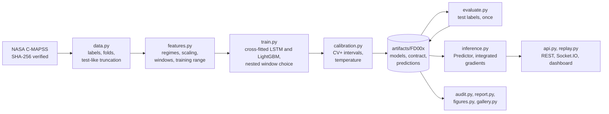

# Turbofan remaining useful life on NASA C-MAPSS: LSTM vs. LightGBM, with prediction intervals and alerts

[](https://github.com/easensoy/ml-predictive-maintenance-system/actions/workflows/ci.yml)

[](LICENSE)

How many cycles does a turbofan engine have left, how uncertain is that estimate, and when should
it raise an alert? This project answers the three questions on NASA's simulated C-MAPSS benchmark
(subsets FD001 to FD004). It evaluates point accuracy, interval coverage and alert behaviour
separately, for a five-network LSTM and a gradient-boosted baseline under one cross-fitted protocol.

<!-- headline:start -->
Under one cross-fitted protocol on the four C-MAPSS subsets, a LightGBM model on four statistics per sensor is at least as accurate as a five-network LSTM: its test RMSE is lower on 3 of 4 subsets, significantly only on FD002, by 1.06 cycles (95% CI +0.26 to +1.93). Accuracy alone does not separate them; the uncertainty and alert evaluations do. The LSTM's nominal 90% intervals are 5 to 35% narrower at similar coverage, and its alert switches itself off again 0.02 to 0.15 times per engine over a whole life, against 0.33 to 0.49 for LightGBM.
<!-- headline:end -->

**What works.** Each prediction comes with a nominal 90% interval that becomes open-ended at the
125-cycle cap, the probability of failure within 30 cycles with an alert at 0.5, and a per-reading
attribution. A REST API serves them, and a dashboard replays held-out engines cycle by cycle.
`predmaint.audit` recomputes every reported result on this page from the committed predictions.

**What is limited.**
- The data are simulated, not field telemetry.
- The target is capped at 125 cycles, so about half of the test engines get an interval that only
  says "at least N cycles".
- Coverage is above nominal overall but below it for engines in mid-life, and out of fold for some
  subsets.
- The test sets were seen during an earlier development round, so the test scores are not those of
  an untouched holdout.

<picture>
  <source media="(prefers-color-scheme: dark)" srcset="predictive-maintenance/docs/figures/hero-dark.png">
  
</picture>

The engine was chosen by a fixed rule (in the figure), not for looking good. The dashboard
section shows it at the cycle its alert first fires.

## Results

<!-- summary:start -->
- **Accuracy.** LightGBM's test RMSE is lower on 3 of 4 subsets; the paired difference (LSTM minus LightGBM) is significant only on FD002, +1.06 cycles (95% CI +0.26 to +1.93). Averaging five fold models lowers RMSE by 0.5 to 1.1 cycles against the mean single fold model, for both families.
- **Uncertainty.** Both models cover 94 to 96% of test engines with a nominal 90% interval, so the intervals are conservative on the test sets. Coverage is not uniform: by true remaining life it falls to 91% for the LSTM (76–100 cycles left) and 81% for LightGBM (51–75 cycles left). Out of fold, over whole lives, it is 88 to 93%, below nominal for LightGBM on FD001 and FD002 and the LSTM on FD003. The LSTM's intervals are narrower on 4 of 4 subsets, by 5 to 35%, significantly on 4.
- **Alerting.** Both alerts rank test engines by risk almost perfectly: average precision 0.984 to 0.999, where a random score would get the base rate of 20 to 25%. Ranking says nothing about calibration, which is measured separately. Over whole lives the first alert comes a median of 30 to 31 cycles before failure; the LSTM's alert switches off again 0.02 to 0.15 times per engine, LightGBM's 0.33 to 0.49 times.
<!-- summary:end -->

<picture>
  <source media="(prefers-color-scheme: dark)" srcset="predictive-maintenance/docs/figures/comparison-dark.png">
  
</picture>

**How to read the comparison.**
- **What is compared.** Both families are served as the average of five fold models, so the filled
  dots are the comparable numbers.
- **The open circles** show how much a single fold model varies. They are not an error bar for the
  average: its uncertainty comes from the three repeats and, for the difference between models, the
  paired bootstrap over test engines on the right.
- **Published results** on C-MAPSS use other caps, splits and test points. They sit in a table with
  their protocols in [the evaluation notes](predictive-maintenance/docs/evaluation.md#published-results),
  not on this axis.

<!-- results:start -->
**Official test sets.** Both models are served as the average of their five cross-fitted fold models. Mean ± sd over 3 repeats of the whole pipeline; bold marks the better model in each subset. The coverage interval is a 95% Wilson interval over test engines at the mean rate. Width counts an open-ended interval up to the 125-cycle cap, so both models are measured on the same engines.

| Subset | Model | RMSE | PHM08 score | RMSE vs actual RUL | Inside the nominal 90% interval (95% CI) | Open-ended intervals | Mean interval width | Alert AP | Alert ECE |
|---|---|---:|---:|---:|---:|---:|---:|---:|---:|
| FD001 (100 engines) | LSTM | 12.94 ± 0.11 | 306 ± 17 | 14.28 ± 0.14 | 95.3 ± 0.6% (89–98%) | 45 ± 2% | 41.5 ± 1.4 cycles | 0.984 ± 0.004 | 0.045 ± 0.007 |
| FD001 (100 engines) | LightGBM | **12.11 ± 0.24** | **244 ± 3** | **13.36 ± 0.21** | 95.0 ± 1.0% (89–98%) | 39 ± 3% | 46.1 ± 2.7 cycles | **0.984 ± 0.002** | 0.044 ± 0.003 |
| FD002 (259 engines) | LSTM | 12.53 ± 0.11 | 643 ± 43 | 25.27 ± 0.37 | 96.4 ± 0.2% (94–98%) | 43 ± 2% | 39.7 ± 0.8 cycles | 0.996 ± 0.002 | 0.029 ± 0.000 |
| FD002 (259 engines) | LightGBM | **11.47 ± 0.10** | **571 ± 13** | **24.04 ± 0.08** | 95.6 ± 1.2% (93–98%) | 40 ± 4% | 41.6 ± 2.5 cycles | **0.999 ± 0.000** | 0.021 ± 0.002 |
| FD003 (100 engines) | LSTM | 13.22 ± 0.26 | 610 ± 55 | 14.90 ± 0.15 | 94.7 ± 3.1% (89–98%) | 42 ± 1% | 37.6 ± 2.9 cycles | **0.987 ± 0.001** | 0.031 ± 0.010 |
| FD003 (100 engines) | LightGBM | **12.03 ± 0.15** | **281 ± 12** | **13.63 ± 0.16** | 95.0 ± 3.0% (89–98%) | 57 ± 15% | 58.0 ± 11.3 cycles | 0.986 ± 0.006 | 0.031 ± 0.007 |
| FD004 (248 engines) | LSTM | **12.82 ± 0.29** | **737 ± 48** | 25.75 ± 0.06 | 95.8 ± 1.3% (93–98%) | 50 ± 0% | 43.1 ± 1.8 cycles | **0.985 ± 0.002** | 0.025 ± 0.004 |
| FD004 (248 engines) | LightGBM | 13.11 ± 0.15 | 905 ± 34 | **25.41 ± 0.11** | 94.2 ± 0.2% (91–97%) | 62 ± 5% | 56.0 ± 3.5 cycles | 0.984 ± 0.002 | 0.012 ± 0.004 |

**LSTM minus LightGBM on the same test engines.** Repeat-averaged difference, with a 95% interval from a paired bootstrap over test engines (2,000 draws). An interval that excludes 0 means the difference is larger than engine-to-engine noise.

| Subset | RMSE, LSTM minus LightGBM | PHM08 score, LSTM minus LightGBM | Coverage, LSTM minus LightGBM (points) | Interval width, LSTM minus LightGBM |
|---|---:|---:|---:|---:|
| FD001 | +0.83 (-0.70 to +2.39) | +62 (-22 to +180) | +0.3 (-2.3 to +3.0) | -4.6 (-7.7 to -1.8) |
| FD002 | +1.06 (+0.26 to +1.93) | +72 (-42 to +190) | +0.8 (-1.4 to +3.1) | -1.9 (-3.4 to -0.5) |
| FD003 | +1.19 (-0.50 to +3.25) | +329 (-53 to +1048) | -0.3 (-4.0 to +3.7) | -20.4 (-26.5 to -14.9) |
| FD004 | -0.30 (-1.04 to +0.46) | -168 (-438 to +14) | +1.6 (-0.9 to +4.2) | -12.9 (-16.0 to -10.1) |

**The alert over whole lives, out of fold.** Every cycle of every cross-fitted training engine, each predicted by a model that never saw it. Mean ± sd over repeats; the ECE interval is the repeat-averaged 95% bootstrap interval over engines.

| Subset | Model | Engines | First alert, median cycles before failure | Missed | First alert more than 30 cycles early | False-alert episodes per engine | Flaps per engine | ECE over all cycles (95% CI) |
|---|---|---:|---:|---:|---:|---:|---:|---:|
| FD001 | LSTM | 90 | 30 ± 1 | 0.0 ± 0.0 | 42.7 ± 3.2 | 0.48 ± 0.04 | 0.02 ± 0.01 | 0.008 ± 0.002 (0.006–0.013) |
| FD001 | LightGBM | 90 | 30 ± 0 | 0.0 ± 0.0 | 42.7 ± 1.5 | 0.61 ± 0.07 | 0.39 ± 0.06 | 0.005 ± 0.003 (0.004–0.009) |
| FD002 | LSTM | 234 | 30 ± 2 | 0.0 ± 0.0 | 111.3 ± 18.2 | 0.52 ± 0.10 | 0.15 ± 0.03 | 0.009 ± 0.003 (0.006–0.012) |
| FD002 | LightGBM | 234 | 30 ± 0 | 0.0 ± 0.0 | 110.3 ± 2.5 | 0.62 ± 0.04 | 0.36 ± 0.03 | 0.005 ± 0.001 (0.004–0.007) |
| FD003 | LSTM | 90 | 30 ± 1 | 0.0 ± 0.0 | 40.7 ± 6.7 | 0.47 ± 0.08 | 0.11 ± 0.02 | 0.008 ± 0.002 (0.005–0.012) |
| FD003 | LightGBM | 90 | 30 ± 0 | 0.0 ± 0.0 | 43.7 ± 1.5 | 0.61 ± 0.03 | 0.33 ± 0.06 | 0.004 ± 0.001 (0.003–0.007) |
| FD004 | LSTM | 224 | 31 ± 1 | 1.7 ± 1.5 | 110.0 ± 8.2 | 0.53 ± 0.05 | 0.12 ± 0.02 | 0.005 ± 0.001 (0.003–0.010) |
| FD004 | LightGBM | 224 | 30 ± 0 | 0.0 ± 0.0 | 105.7 ± 2.3 | 0.65 ± 0.01 | 0.49 ± 0.01 | 0.004 ± 0.001 (0.003–0.008) |
<!-- results:end -->

## Quick start

Check the published numbers and run the dashboard, with no data download and no GPU:

```bash
cd predictive-maintenance
uv sync
uv run python -m predmaint.audit     # recompute every result above; exit code 1 on any mismatch
uv run python -m predmaint.serve     # dashboard at http://127.0.0.1:5000
```

It needs [uv](https://docs.astral.sh/uv/) (tested with 0.13.7) and Python 3.15, which uv can
install.

## How it was evaluated

The sampling unit is the engine: no split ever puts cycles of one engine on both sides.

- **Held out.** For each subset, 10% of the training engines are set aside for the dashboard
  replay. No network, scaler or calibration step sees them.
- **Cross-fitted.** The rest are split into five folds stratified by life length, and every fold
  model is trained without one fold.
- **Model selection.** Inside each fold's training engines, an 85/15 split chooses the input window
  (30, 40, 50 or 60 cycles) and the early-stopping point. The architecture and optimiser settings
  were fixed beforehand.
- **Calibration, never on a selection engine.** Each engine's conformity score comes from the one
  fold model that never saw it. The score is taken at one truncation point per engine, drawn from
  the official test trajectory lengths, so calibration points look like test points. These scores
  give CV+ intervals, nominally 90%. The alert temperature is fitted out of fold on ten truncations
  per engine, and the alert threshold of 0.5 was fixed in advance.
- **The test set, once.** Training never reads NASA's test labels. `predmaint.evaluate` scores all
  three repeats of both models once per subset and records it in the
  [experiment ledger](predictive-maintenance/docs/experiment-ledger.md).
- **Repeats.** The whole pipeline ran three times with different seeds; tables show mean ± sd.
  Model differences use a paired bootstrap over test engines.

[`docs/evaluation.md`](predictive-maintenance/docs/evaluation.md) has the details, the published
results with their protocols, more figures, and the status of every finding from the last review.

### Uncertainty

<picture>
  <source media="(prefers-color-scheme: dark)" srcset="predictive-maintenance/docs/figures/uncertainty-dark.png">
  
</picture>

- **Two populations.** The test sets score one point per engine, at its last observed cycle. Out of
  fold scores every cycle of every cross-fitted engine, with engines weighted equally. Their
  coverages differ because they contain different mixes of remaining life.
- **The cap.** An interval that reaches 125 cycles is reported as "at least the lower end", in the
  tables, the API and the dashboard. Under that reading, covering the capped target and covering the
  actual remaining life are the same event. Read as a closed range ending at 125, as version 2 of
  this project did, the same intervals would miss every engine with more than 125 cycles left.
- **What "nominal" means.** CV+ guarantees at least 80% for engines exchangeable with the training
  engines. The calibration points match the test sets' trajectory lengths, which needs no labels,
  but not their distribution of remaining life, which would. So 90% is a target, and the plot shows
  where it is missed.

### Alerts

<picture>
  <source media="(prefers-color-scheme: dark)" srcset="predictive-maintenance/docs/figures/alerts-dark.png">
  
</picture>

- **Average precision.** It is computed from the probability of failure within 30 cycles,
  treating each test engine as positive when it fails within 30 cycles of its last observed cycle.
  It shows how well the score ranks engines, not whether its probabilities are right.
- **Calibration** is the reliability diagram. Bins pool consecutive cycles of the same engine,
  which are dependent, and most cycles have a probability below 0.1. The ECE intervals in the
  tables therefore resample whole engines.
- **Early alerts.** "Missed" means no alert while at least one cycle was left. About half of first
  alerts come before the 30-cycle horizon, most within 10 cycles of it. A probability crossing 0.5
  near 30 cycles is expected to land on both sides of that line.

### Attributions

<picture>
  <source media="(prefers-color-scheme: dark)" srcset="predictive-maintenance/docs/figures/attribution-dark.png">
  
</picture>

Every prediction comes with integrated gradients: how much each reading in the input window moved
the predicted RUL, in cycles, relative to an average engine in the same operating regime.
`predmaint.attribution_checks` tests whether that is more than decoration:

<!-- attribution:start -->
On 40 windows from 10 FD001 replay engines (at 100, 60, 30, 10 cycles before failure), with the served five-network average:

- **Completeness holds.** The attributions add up to the change in prediction to within 0.04 cycles (median), against a median change of 69 cycles.
- **They find readings the output depends on.** Removing readings in attribution order moves the prediction to the baseline far faster than random order: median deletion area 0.097 against 0.557 (lower is better), better in 32 of 40 windows.
- **But much of that is input deviation.** Ranking readings simply by how far they are from the baseline does almost as well (deletion area 0.132; attributions win in 26 of 40 windows, and in 18 of 40 on insertion).
- **The trained weights matter, moderately.** A randomly re-initialised network gives maps that rank-correlate 0.55 with the trained ones and delete less well (0.190).
- **The baseline matters.** Using each engine's own first cycles as the baseline instead of the regime average changes the maps (rank correlation 0.54; the top three sensors keep 2 of 3 in the median window).
<!-- attribution:end -->

So the attributions are faithful to the model's output and better than chance or an untrained
network, but they mostly highlight readings that are far from normal. Read them as what the
prediction depends on, not as a diagnosis of the engine. The check curves are in
[the evaluation notes](predictive-maintenance/docs/evaluation.md#attribution-checks).

## Failure cases and limitations

[`docs/failure-cases.md`](predictive-maintenance/docs/failure-cases.md) lists the worst interval
misses and the earliest, latest and missed alerts. It is generated by `python -m predmaint.gallery`.
The pattern it shows:

- **Errors peak in mid-life.** The largest errors are for engines roughly 50 to 100 cycles from
  failure, where both models overestimate the remaining life. That is the dangerous direction, and
  it is where coverage drops below nominal.
- **Most of the worst misses are open-ended intervals** for engines in that range that the model
  still read as healthy. The rest are the opposite error: engines predicted closer to failure than
  they were.
- **Alerts go wrong mainly on the six-condition subsets.** The only first alerts more than 60 cycles
  early are on FD002 and FD004. The only missed engines are the LSTM's, on FD004, which also has two
  fault modes.

Limitations:

- **C-MAPSS is simulated.** It is the standard benchmark for this problem, but good numbers here do
  not show field performance.
- **The test sets are not untouched.** Version 2's development runs printed test scores, and all of
  them are in the ledger. The final evaluation scored each test set once, but the architecture it
  inherited was chosen during that development.
- **The intervals are nominal.** They over-cover on the test sets and under-cover in mid-life.
- **The window grid may stop too early.** The longest candidate window, 60 cycles, won most
  folds, and on FD002 and FD004 inner-validation RMSE was still clearly falling at 60.
- **The alert threshold is not tuned** to any cost of missed or false alerts.
- **The attributions mostly track input deviation** (see above).
- **Single-process demo.** The replay lives in process memory and runs with one gunicorn worker.
  The API is read-only, holds no user data and has no authentication.

The [model card](MODEL_CARD.md) covers intended use and out-of-scope uses.

## Dashboard and API

The dashboard replays the FD001 engines held out of training, one recorded cycle per tick, with
the prediction, its interval, the alert and the attribution of each watched engine. It is a replay
of simulated data, not a live feed.

<picture>
  <source media="(prefers-color-scheme: dark)" srcset="predictive-maintenance/docs/figures/dashboard-dark.png">
  
</picture>

<!-- dashboard:start -->
Both captures show the same replay state: FD001 replay engine 81 at cycle 207 of 240, the cycle at which its alert first fires (the hero figure shows its whole life). The dashboard predicts 32 cycles (nominal 90% interval 18 to 51) and a 51% probability of failure within 30 cycles; the true RUL, known because the simulated engine ran to failure, is 33. These are the numbers in that engine's row of `replay-holdout.csv.gz`, which `predmaint.audit` checks.
<!-- dashboard:end -->

`?engine=<unit>` opens one engine, `&only=detail` shows just its panel and `&only=prediction` just
its prediction, as above. `python -m predmaint.screenshots` reproduces both images.

| Method | Path | Returns |
|---|---|---|
| POST | `/api/predict` | RUL with its interval (open-ended at the cap), failure probability, status, attribution and an out-of-distribution report |
| GET | `/api/model-info` | the served model's test metrics, windows, calibration and provenance |
| GET | `/api/fleet` | the current state of every replayed engine |
| GET | `/api/engines/<unit>` | one engine's prediction history, attribution heatmap and sensor traces |
| GET | `/api/health` | `ok` only if a smoke inference succeeds, otherwise 503 |

`/api/predict` takes raw cycles, oldest first: the three operational settings and the 14 sensors
the model uses. Values must be finite JSON numbers. Short histories are padded, and the response
says so. Readings outside the training range are named in `out_of_distribution`. If the network
cannot give a finite answer, the API returns 422 with the same report.

```bash
curl -s -X POST http://127.0.0.1:5000/api/predict \
     -H "Content-Type: application/json" \
     -d @predictive-maintenance/docs/example-request.json
```

<!-- api-example:start -->
```json
{
  "rul": {"point": 56.0, "lower": 35.7, "upper": 80.6, "open_ended": false, "summary": "36 to 81 cycles", "interval": 0.9, "capped_at": 125},
  "failure_within_horizon": {"horizon_cycles": 30, "probability": 0.0268, "alert": false},
  "status": "healthy",
  "cycles_received": 70,
  "window_padded": false,
  "out_of_distribution": {"flag": false, "rows_checked": 60, "sensors_outside_training_range": [], "rows_with_unseen_operating_settings": 0},
  "explanation": {"method": "integrated gradients vs. an average engine in the same operating regime", "baseline_rul_cycles": 117.6, "sensors": [{"symbol": "NRf", "description": "Corrected fan speed", "contribution_cycles": -11.15}, {"symbol": "T50", "description": "Total temperature at LPT outlet", "contribution_cycles": -8.79}, {"symbol": "Ps30", "description": "Static pressure at HPC outlet", "contribution_cycles": -7.75}]}
}
```

The request holds 70 cycles of FD001 test engine 3, ending at the last of its 126 recorded cycles, and the response matches, to its rounding, the prediction scored for that engine in the test table (LSTM, served repeat). NASA's true RUL for it is 69 cycles: inside the interval, 13 cycles above the point estimate. The explanation is trimmed to its three largest sensor effects (11 more in the full response, [`docs/example-response.json`](predictive-maintenance/docs/example-response.json)).
<!-- api-example:end -->

**Latency.**

<!-- latency:start -->
Measured in process on an Intel Core Ultra 7 165H with 16 PyTorch threads, CPU only, for the served 5-network FD001 model:

| Operation | Median (p95) |
|---|---|
| Prediction | 11 ms (p95 13 ms) |
| Prediction with integrated gradients | 255 ms (p95 274 ms) |
| Replay tick, whole 10-engine fleet, no attributions | 61 ms (p95 64 ms) |
| Attribution refresh for one watched engine | 243 ms (p95 278 ms) |

The replay ticks every 1000 ms. At the 95th percentile, the fleet step plus 2 attribution refreshes takes 620 ms, and one more refresh would take it to 898 ms. So each tick refreshes at most `PM_EXPLAIN_PER_TICK` watched engines (2 by default), taking turns when more are watched.
<!-- latency:end -->

## Architecture



- **One feature contract.** `features.py` turns raw readings into model windows and is saved next
  to the model as `contract.json`, with the training range of every feature. Training, the API and
  the replay use this one code path, and a test checks that a served window equals the training
  window for the same cycles. The server refuses to start on artifacts it cannot use.
- **The model.** A 2-layer LSTM with attention pooling feeds two heads: the RUL point (MSE) with
  its 5th and 95th percentiles (pinball loss), and the logit of failure within 30 cycles. Each of
  the five networks reads its own window length, and the served prediction averages them.
- **The baseline.** LightGBM reads four statistics per sensor over the same window: the last
  value, the mean, the standard deviation and the slope. It gets the same folds, window choice,
  interval calibration and alert calibration.

## Reproduce

The commands below run from `predictive-maintenance/`.

**Check the shipped results.** These are read-only: no download, no training.

```bash
uv run python -m predmaint.audit                  # recompute every table, interval and generated block
uv run python -m predmaint.figures --out /tmp/f   # rebuild the figures from the committed predictions
uv run pytest                                     # synthetic-data tests, plus the audit
```

**Regenerate the documents** from the committed artifacts. These rewrite files in `docs/` and the
generated blocks here and in the model card:

```bash
uv run python -m predmaint.report        # tables, findings and the API example
uv run python -m predmaint.figures       # docs/figures
uv run python -m predmaint.gallery       # docs/failure-cases.md
uv run python -m predmaint.screenshots   # dashboard images; needs Edge, Chrome or Chromium
```

**Retrain.** This replaces the published results:

```bash
uv run python -m predmaint.data download          # 12 MB from NASA, checksum-verified
uv run python -m predmaint.train --subset FD001   # and FD002, FD003, FD004
uv run python -m predmaint.evaluate               # reads the test labels; the ledger records it
uv run python -m predmaint.attribution_checks
uv run python -m predmaint.benchmark
```

`predmaint.train` refuses to run from uncommitted sources, so every `metrics.json` names the commit
that produced it; `--allow-dirty` overrides that for experiments, and the ledger records it. The
published runs were trained on a laptop GPU, an NVIDIA RTX 1000 Ada with the CUDA build of PyTorch
2.15. The locked environment installs CPU PyTorch, which runs the same pipeline roughly ten times
slower, and GPU runs are not bit-for-bit reproducible across devices.

Docker serves the dashboard with gunicorn as a non-root user, with a health check:

```bash
docker build -t predmaint predictive-maintenance
docker run --rm -p 8000:8000 predmaint             # http://localhost:8000
```

## Data, references, licence and history

- **Data.** A. Saxena, K. Goebel, D. Simon and N. Eklund, "Damage Propagation Modeling for Aircraft
  Engine Run-to-Failure Simulation", *PHM08*, 2008,
  [doi:10.1109/PHM.2008.4711414](https://doi.org/10.1109/PHM.2008.4711414). The dataset comes from
  the NASA Prognostics Center of Excellence.
  - NASA does not specify a licence for it, so the raw files are not redistributed here;
    `predmaint.data download` fetches them.
  - The rows this repository does contain are listed in the [model card](MODEL_CARD.md#data).
- **Code.** [MIT licence](LICENSE). To cite this software, use [CITATION.cff](CITATION.cff).
- **Methods.**
  - R. F. Barber, E. J. Candès, A. Ramdas and R. J. Tibshirani, "Predictive inference with the
    jackknife+", *Annals of Statistics* 49(1), 2021 (CV+).
  - Y. Romano, E. Patterson and E. Candès, "Conformalized Quantile Regression", *NeurIPS*, 2019.
  - C. Guo, G. Pleiss, Y. Sun and K. Q. Weinberger, "On Calibration of Modern Neural Networks",
    *ICML*, 2017.
  - M. Sundararajan, A. Taly and Q. Yan, "Axiomatic Attribution for Deep Networks", *ICML*, 2017.
  - J. Adebayo, J. Gilmer, M. Muelly, I. Goodfellow, M. Hardt and B. Kim, "Sanity Checks for
    Saliency Maps", *NeurIPS*, 2018.

  The published C-MAPSS results referred to above are cited in
  [the evaluation notes](predictive-maintenance/docs/evaluation.md#published-results).
- **History.**
  - **Version 1 (2025)** described a "production-ready" system. Its data were synthetic, its model
    could not serve a prediction, its dashboard metrics were hard-coded and its "live sensors" were
    random numbers.
  - **Version 2 (6 November 2026)** rebuilt it on C-MAPSS. An outside review then found that
    calibration reused the engines that had chosen the model, that the intervals were read as closed
    at the cap, and that several claims went beyond the evidence.
  - **Version 2.1 (8 November 2026)** is this repository. It fixed those problems and reran the
    evaluation as described above. Both earlier versions remain in the git history.
