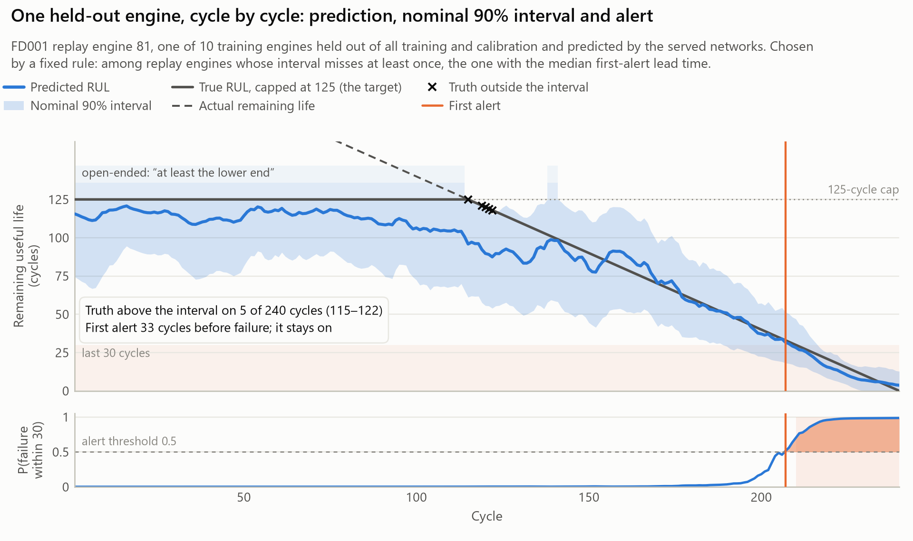
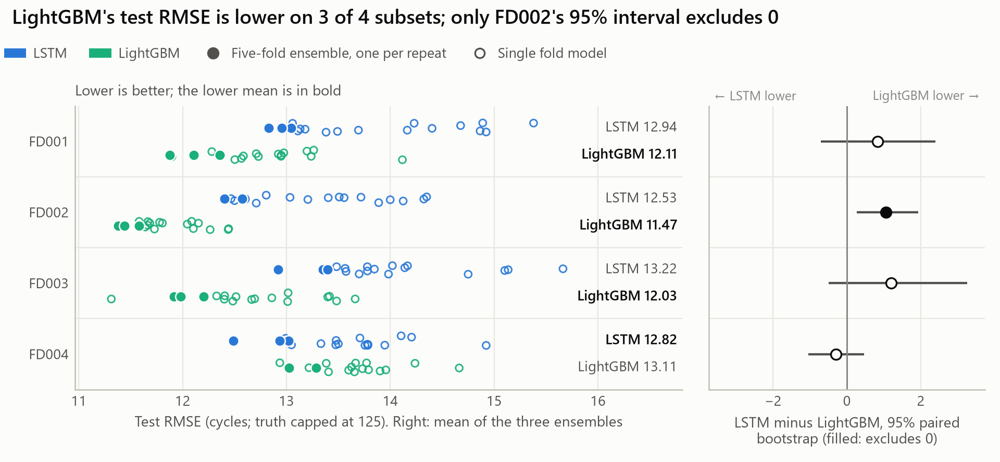
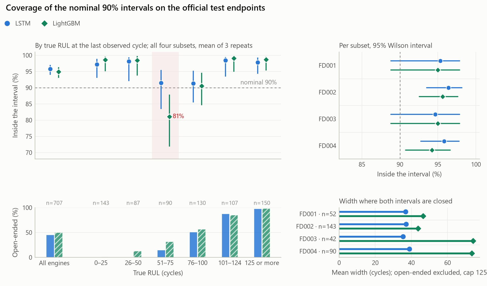
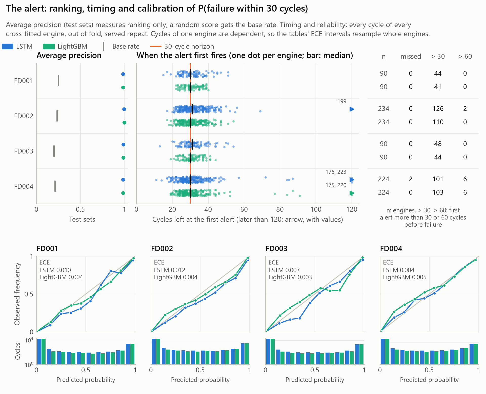
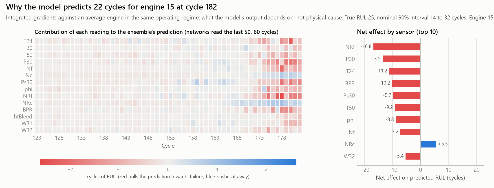
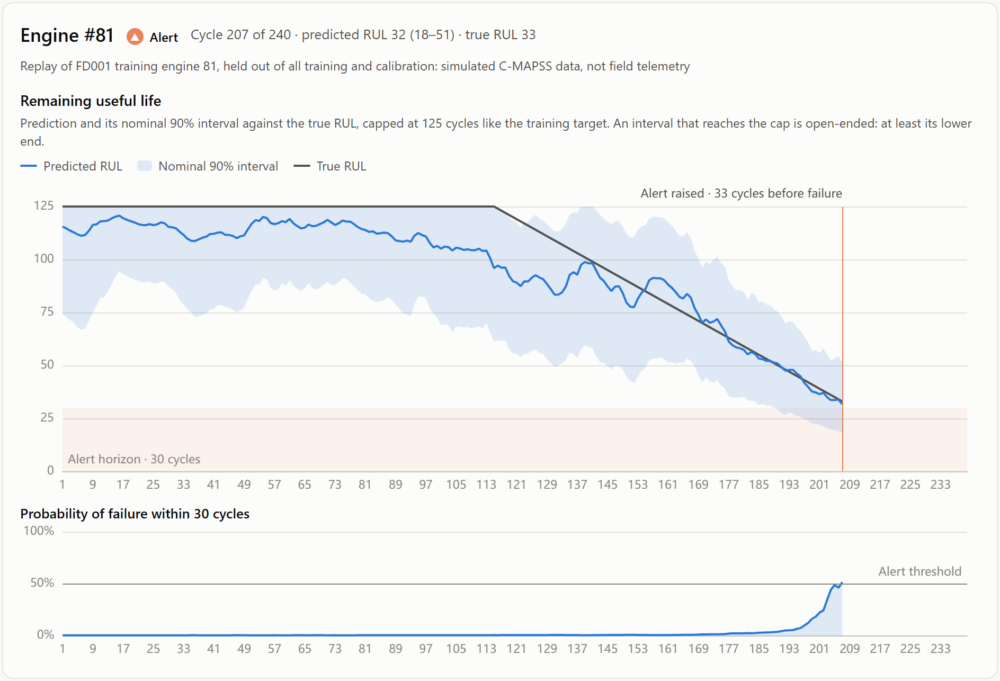

# Turbofan remaining useful life on NASA C-MAPSS: a cross-fitted LSTM–LightGBM comparison

[](https://github.com/easensoy/ml-predictive-maintenance-system/actions/workflows/ci.yml?query=branch%3Amaster)

[](LICENSE)

<!-- headline:start -->
An LSTM on raw sensor windows and LightGBM on per-sensor window statistics predict remaining useful life on NASA's simulated C-MAPSS turbofans under one engine-disjoint cross-fitting protocol, scored separately on point error, nominal 90% intervals and a 30-cycle alert. LightGBM is at least as accurate (lower test RMSE on 3 of 4 subsets; paired 95% interval excludes zero only on FD002); the LSTM gives narrower intervals at similar coverage and an out-of-fold alert that switches off less often but misses engines.
<!-- headline:end -->

<picture>
  <source media="(prefers-color-scheme: dark)" srcset="predictive-maintenance/docs/figures/hero-dark.png">
  
</picture>

<sub>A replay-holdout engine, excluded from training, preprocessing, model selection and calibration, predicted at every cycle by the deployed LSTM ensemble. A fixed rule chose it: among replay engines whose interval misses the capped truth at least once, the one with the median first-alert lead time.</sub>

<!-- findings:start -->
- **Point accuracy.** LightGBM's test RMSE is lower on 3 of 4 subsets, but the paired difference excludes zero only on FD002: +1.06 cycles (95% CI +0.26 to +1.93).
- **Intervals.** Pooled over 707 test engines, coverage of the nominal 90% intervals is 95.8% (LSTM) and 95.0% (LightGBM), with 39–62% open-ended; the LSTM's intervals are narrower on every subset under all three width statistics.
- **Alert dynamics.** Out of fold, both alerts first fire a median 30–31 cycles before failure; LightGBM's switches off again 0.33–0.49 times per engine against the LSTM's 0.02–0.15, but only the LSTM misses engines.
<!-- findings:end -->

**[Protocol](predictive-maintenance/docs/evaluation.md#protocol)** · **[How to read the results](#how-to-read-the-results)** · **[Test-set exposure](#test-set-exposure)** · **[Failure analysis](#failure-analysis)** · **[Reproduction](#reproduce)**

## Contribution

- **A controlled comparison.** An LSTM reading raw sensor windows and LightGBM reading four
  statistics per sensor over the same windows share the engine-disjoint folds, the
  inner-validation window selection, the interval construction and the alert calibration, so the
  comparison is between two model families under one protocol.
- **Three targets, evaluated separately.** Error against the capped target; empirical coverage,
  open-ended share and width of the intervals; and the alert's ranking, calibration, threshold
  decisions and temporal stability, each on a named population.
- **Auditable artifacts.** `predmaint.audit` recomputes every metric in `metrics.json` from the
  committed predictions, rebuilds every test interval from the fold models' quantile outputs and
  the stored conformity scores, regenerates every generated block of the documents, rechecks the
  engine-separation rules and verifies the artifact hashes. That shows the documents agree with
  the artifacts, not that the method is valid.
- **Failure analysis.** Error and coverage by remaining-life band, the worst interval misses, and
  the earliest, latest and missed alerts, engine by engine.

Neither model is new, and no state-of-the-art claim is made. Published C-MAPSS results use other
caps, splits and test points, so they are
[listed with their protocols](predictive-maintenance/docs/evaluation.md#published-results) rather
than ranked against these.

## Results

<!-- summary-table:start -->
| Subset (test engines) | Test RMSE | LSTM − LightGBM RMSE (95% CI) | Coverage at nominal 90% | Open-ended intervals | Mean width (truncated at 125) | Switch-offs per engine (out of fold) |
|---|---:|---:|---:|---:|---:|---:|
| FD001&nbsp;(100) | 12.94&nbsp;/&nbsp;**12.11** | +0.83&nbsp;(-0.70&nbsp;to&nbsp;+2.39) | 95%&nbsp;/&nbsp;95% | 45%&nbsp;/&nbsp;39% | **41.5**&nbsp;/&nbsp;46.1 | **0.02**&nbsp;/&nbsp;0.39 |
| FD002&nbsp;(259) | 12.53&nbsp;/&nbsp;**11.47** | +1.06&nbsp;(+0.26&nbsp;to&nbsp;+1.93) | 96%&nbsp;/&nbsp;96% | 43%&nbsp;/&nbsp;40% | **39.7**&nbsp;/&nbsp;41.6 | **0.15**&nbsp;/&nbsp;0.36 |
| FD003&nbsp;(100) | 13.22&nbsp;/&nbsp;**12.03** | +1.19&nbsp;(-0.50&nbsp;to&nbsp;+3.25) | 95%&nbsp;/&nbsp;95% | 42%&nbsp;/&nbsp;57% | **37.6**&nbsp;/&nbsp;58.0 | **0.11**&nbsp;/&nbsp;0.33 |
| FD004&nbsp;(248) | **12.82**&nbsp;/&nbsp;13.11 | -0.30&nbsp;(-1.04&nbsp;to&nbsp;+0.46) | 96%&nbsp;/&nbsp;94% | 50%&nbsp;/&nbsp;62% | **43.1**&nbsp;/&nbsp;56.0 | **0.12**&nbsp;/&nbsp;0.49 |

Each cell is LSTM / LightGBM, the mean over 3 repeats; bold marks the lower value where lower is better. Test columns score the official test endpoints; coverage reads an open-ended interval as [lower, ∞), and width truncates it at the 125-cycle cap (a summary defined after the test labels were read). Switch-offs are counted out of fold, for single fold models.

**Where each model is better**

- **LightGBM:** lower test RMSE on FD001, FD002 and FD003 (the CI excludes zero only on FD002), lower PHM08 score on FD001, FD002 and FD003 (no CI excludes zero), lower RMSE against the uncapped remaining life on all 4 subsets and no missed engines out of fold (the LSTM misses engines on FD004).
- **LSTM:** lower test RMSE on FD004 (the CI includes zero), lower PHM08 score on FD004 (the CI includes zero), narrower truncated widths on all 4 subsets (every CI excludes zero) and fewer out-of-fold alert switch-offs on all 4 subsets.
- **Neither:** no coverage difference excludes zero on any subset, and alert average precision is 0.984 to 0.999 for both.
<!-- summary-table:end -->

<picture>
  <source media="(prefers-color-scheme: dark)" srcset="predictive-maintenance/docs/figures/comparison-dark.png">
  
</picture>

<sub>Left, the principal comparison: the paired difference with its 95% engine-bootstrap interval, filled where the interval excludes zero. Right, each model's RMSE: large markers are the mean of the three repeat ensembles, small ones each repeat. Single fold models are in the evaluation notes.</sub>

The [full results](predictive-maintenance/docs/evaluation.md#full-results) add the PHM08 score,
RMSE against the uncapped RUL, every paired difference, alert calibration, and whole-life
statistics for the single fold models and for the ensembles on the replay holdout.

## Evaluation design

**Conventions.** RUL is the number of cycles an engine runs after the current one, and the target
is min(RUL, 125). An interval [L, U] has nominal coverage 90%. If U reaches 125, the interval is
open-ended and reported as [L, ∞), "at least L cycles"; because L ≤ 125, the capped target lies
in [L, ∞) exactly when the actual RUL does. Coverage means empirical, marginal coverage: the
share of a population's predictions whose target lies in the interval.

**Engine-disjoint partitions.** The engine is the sampling unit; no partition splits one
engine's cycles.

| Partition | Engines | Use |
|---|---|---|
| Replay holdout | 10% of each subset's training engines, stratified by life length and fixed across repeats | Dashboard replay and whole-life evaluation of the ensembles. Never used for training, preprocessing, model selection or calibration. |
| Cross-fitting folds | The other 90%, in five folds stratified by life length, redrawn in each repeat | Fold model k trains on four folds; fold k supplies its out-of-fold predictions and conformity scores. |
| Inner validation | 15% of each fold model's training engines | Model selection: the input window (30, 40, 50 or 60 cycles), early stopping and, for the LSTM, the learning-rate schedule. |
| Official test set | NASA's truncated test trajectories | Scored once per subset. Only the observed trajectory lengths enter calibration. |

**Preprocessing.** Feature scaling and operating-regime clustering are fitted once per subset, on
the unlabelled sensor readings of all cross-fitted engines; they are not refitted inside each
fold.

**Intervals.** Conformalized quantile regression (CQR) scores, aggregated by CV+ over the five
fold models. Each cross-fitted engine contributes one score, at one truncation point drawn from
the official test trajectory lengths, from the fold model that never saw it. The finite-sample
CV+ guarantee requires conditions this setup does not meet, so the intervals have nominal, not
guaranteed, coverage ([the conditions](predictive-maintenance/docs/evaluation.md#what-the-conformal-guarantee-covers)).

**Alert.** The probability of failure within 30 cycles comes from a classification head of the
LSTM and from a separate LightGBM classifier, temperature-scaled out of fold. The alert fires at
0.5, a threshold fixed before evaluation and not tuned to any cost.

**Populations.**

| Population | Predictions | Model form | Reported |
|---|---|---|---|
| Test endpoints | One per official test engine, at its last observed cycle | Each repeat's five-fold ensemble, with the CV+ interval | RMSE, PHM08 score, coverage, open-ended share, width, alert AP and ECE |
| Out of fold | Every cycle of every cross-fitted engine | The single fold model that never saw the engine, its quantiles widened by the conformal quantile of the other folds' scores | Whole-life coverage, alert lead time, misses, switch-offs, reliability |
| Replay holdout | Every cycle of the held-out engines | Each repeat's five-fold ensemble; the first repeat's LSTM is deployed | Whole-life ensemble statistics, the hero figure, the dashboard, the attribution checks |

**Repeat variability and sampling uncertainty.** The pipeline ran three times, with different
fold assignments, inner splits, initialisations and calibration truncations; ± is the sample
standard deviation over these repeats. Paired differences carry 95% percentile intervals from
an engine-level bootstrap whose 2,000 resamples are shared by both models and all repeats. They
reflect which engines are in the test set, exclude repeat variability and are not corrected for
multiple comparisons. Coverage intervals are Wilson intervals over engines.

### Test-set exposure

- **Development exposure.** Version 2's development runs (6 November 2026) printed test-set
  RMSE, coverage and alert AP after every run. The window grid was explored, and input smoothing
  and two calibration variants were dropped, with those scores visible
  ([experiment ledger](predictive-maintenance/docs/experiment-ledger.md)). The architecture and
  optimiser settings were set before those runs and carried into the final pipeline unchanged.
- **The final evaluation event.** The final pipeline's training reads no test labels.
  `predmaint.evaluate` read them once per subset, on 7 and 8 November 2026, for runs trained from
  one clean commit, and the ledger records each event. Every statistic in `metrics.json` was
  defined in that commit. Summaries added afterwards, which read the labels stored in the
  committed prediction files, are
  [labelled post hoc](predictive-maintenance/docs/evaluation.md#summaries-defined-after-the-test-labels-were-read).
- **No untouched data.** Every C-MAPSS engine, in the training and the test files, was used
  during development. One final evaluation event does not make the test sets an independent
  holdout, and re-evaluating on another part of C-MAPSS would not restore independence. These
  are development-exposed benchmark estimates.

### Intervals

<picture>
  <source media="(prefers-color-scheme: dark)" srcset="predictive-maintenance/docs/figures/uncertainty-dark.png">
  
</picture>

- **Marginal coverage hides structure.** Test-endpoint coverage averages over engines at every
  remaining life, and an open-ended interval covers almost every engine far from failure.
  Coverage by true RUL (lower panel) is a diagnostic, not a guarantee: in mid-life it falls to
  about nominal for the LSTM and below it for LightGBM.
- **The open-ended reading matters.** Read as closed at 125 instead, the same intervals would
  contain the actual RUL far less often
  ([interval width](predictive-maintenance/docs/evaluation.md#interval-width)).
- **Width.** The middle panel truncates open-ended intervals at the cap (mean ± sd over repeats),
  a summary defined after the test labels were read. The evaluation notes compare it with the
  width on engines where both intervals are closed and with the width over each model's own
  closed intervals, the only one of the three fixed before the test labels were read.
- **Two populations.** Out-of-fold coverage (diamonds) weights engines equally over whole lives,
  for single fold models. Both the population and the interval construction differ from the test
  endpoints', so the two coverages are not comparable estimates of one quantity.

### Alerts

<picture>
  <source media="(prefers-color-scheme: dark)" srcset="predictive-maintenance/docs/figures/alerts-dark.png">
  
</picture>

The alert is evaluated in four respects, each on a stated population:

- **Ranking.** Average precision of the failure probability on the test endpoints (ensembles),
  against the base rate.
- **Calibration.** Expected calibration error on the test endpoints (ensembles, one point per
  engine) and out of fold (single fold models, every cycle, intervals from resampling engines),
  with reliability diagrams
  ([alert ranking and calibration](predictive-maintenance/docs/evaluation.md#alert-ranking-and-calibration)).
  The served probability averages five members scaled by a temperature fitted for single fold
  models.
- **Threshold decisions.** Out of fold, at the fixed threshold: cycles left at the first alert,
  missed engines (no alert while at least one cycle is left), and first alerts with more than 30
  or 60 cycles left.
- **Temporal stability.** Out of fold: switch-offs, the alert turning off again before failure.
  Some end alerts that began early, so the findings also count only the switch-offs in the last
  30 cycles.

The dot strip and counts show the first repeat; switch-offs are means over three repeats. Fewer
switch-offs alone do not make an alert more useful: the costs of early, late and missed alerts
are not modelled, and the threshold is not tuned to them.

### Attributions

<picture>
  <source media="(prefers-color-scheme: dark)" srcset="predictive-maintenance/docs/figures/attribution-dark.png">
  
</picture>

Integrated gradients for the hero engine at its first alert, relative to a reference window in
which every scaled reading equals its operating regime's training mean. Each cell is one
reading's contribution to the predicted RUL, in cycles, and the cells sum to the prediction minus
the reference's prediction. Left of the dashed line are cycles that only the networks with the
longest window read.

The [attribution checks](predictive-maintenance/docs/evaluation.md#attribution-checks) test these
maps on held-out FD001 engines at four stages of life. In the median window, deleting readings
in attribution order moves the prediction toward the reference faster than random order or a
re-initialised network's order. But ranking readings by their distance from the reference alone
does about as well, the medians hide a tail of windows where attribution order is worse than
random, and the maps change with the reference. Completeness holds by construction and says
nothing about faithfulness. The maps describe what the prediction is sensitive to, relative to
the regime mean; they do not explain why an engine degrades.

## Failure analysis

- **Mid-life engines.** Both models make their largest errors on engines roughly 50 to 100
  cycles from failure. There they mostly overestimate the remaining life, the unsafe direction,
  and coverage falls to about nominal (LSTM) or below it (LightGBM).
- **Open-ended intervals on wearing engines.** Most of the worst interval misses are "at least L
  cycles" intervals for engines in that range that the model still reads as healthy.
- **The six-condition subsets.** Every first alert with more than 60 cycles left is on FD002 or
  FD004, and the only missed engines are the LSTM's, on FD004.
- **Out-of-fold coverage.** Over whole lives, coverage of the single fold models is below nominal
  for LightGBM on FD001 and FD002 and for the LSTM on FD003.

The [failure-case gallery](predictive-maintenance/docs/failure-cases.md) lists the worst misses and
the earliest, latest and missed alerts, engine by engine.

## Serving

<picture>
  <source media="(prefers-color-scheme: dark)" srcset="predictive-maintenance/docs/figures/dashboard-dark.png">
  
</picture>

<!-- dashboard:start -->
Both captures show the same replay state: FD001 replay engine 81 at cycle 207 of 240, the cycle at which its alert first fires (the hero figure shows its whole life). The dashboard predicts 32 cycles (nominal 90% interval 18 to 51) and a 51% probability of failure within 30 cycles; the true RUL, known because the simulated engine ran to failure, is 33. These are the numbers in that engine's row of `replay-holdout.csv.gz`, which `predmaint.audit` checks.
<!-- dashboard:end -->

The dashboard replays simulated C-MAPSS engines from the replay holdout, one recorded cycle per
tick; it is not a live feed or field telemetry. Run it with `uv run python -m predmaint.serve`.
The REST API, a real example response, serving latency, Docker and the architecture are in
[`docs/serving.md`](predictive-maintenance/docs/serving.md).

## Reproduce

From `predictive-maintenance/`, with [uv](https://docs.astral.sh/uv/) (tested with 0.13.7) and
Python 3.15, which uv can install.

**Check the published results.** These commands are read-only, need no download and no GPU, and
are what CI runs:

```bash
uv sync
uv run python -m predmaint.audit                  # recompute every table, interval and generated block
uv run python -m predmaint.figures --out /tmp/f   # rebuild every figure from the committed predictions
uv run pytest                                     # synthetic-data tests, plus the audit
```

**Regenerate the documents.** These rewrite files in `docs/` and the generated blocks in the
README, the model card, the evaluation notes and the serving page:

```bash
uv run python -m predmaint.report        # findings, tables and the API example
uv run python -m predmaint.figures       # docs/figures
uv run python -m predmaint.gallery       # docs/failure-cases.md
uv run python -m predmaint.screenshots   # dashboard images; needs Edge, Chrome or Chromium
```

**Retrain.** This replaces the published results:

```bash
uv run python -m predmaint.data download          # 12 MB from NASA, checksum-verified
uv run python -m predmaint.train --subset FD001   # and FD002, FD003, FD004
uv run python -m predmaint.evaluate               # reads the test labels; the ledger records it
uv run python -m predmaint.attribution_checks
uv run python -m predmaint.benchmark
```

`predmaint.train` refuses to run from uncommitted sources, so every `metrics.json` names the commit
that produced it. The published runs were trained on a laptop GPU (NVIDIA RTX 1000 Ada, CUDA build
of PyTorch 2.15). The locked environment installs CPU PyTorch, which runs the same pipeline roughly
ten times slower. GPU runs are not bit-for-bit reproducible across devices, so a rerun reproduces
the protocol, not the exact numbers.

## Documentation

- [Evaluation notes](predictive-maintenance/docs/evaluation.md): the protocol, the conformal
  construction and the conditions its guarantee needs, the three populations, the width
  statistics, the full per-subset tables, alert ranking and calibration, the attribution checks,
  the post hoc summaries and the published results.
- [Experiment ledger](predictive-maintenance/docs/experiment-ledger.md): every training and
  evaluation run, including each time the test sets were viewed.
- [Failure-case gallery](predictive-maintenance/docs/failure-cases.md): the worst interval misses
  and the earliest, latest and missed alerts.
- [Model card](MODEL_CARD.md): intended and out-of-scope uses, data and caveats.
- [Serving](predictive-maintenance/docs/serving.md): the API, latency, Docker and architecture.
- [Maintenance-note harness](predictive-maintenance/docs/notes-eval/README.md): an optional,
  unused evaluation harness for language-model-written maintenance notes. Only its deterministic
  template baseline has been graded; no model call has been made, so no model fidelity,
  abstention, latency or cost result exists.

## Data, licence and history

- **Data.** A. Saxena, K. Goebel, D. Simon and N. Eklund, "Damage Propagation Modeling for Aircraft
  Engine Run-to-Failure Simulation", *PHM08*, 2008,
  [doi:10.1109/PHM.2008.4711414](https://doi.org/10.1109/PHM.2008.4711414), from the NASA
  Prognostics Center of Excellence. NASA does not state a licence for it, so the raw files are not
  redistributed here; `predmaint.data download` fetches them. The rows this repository does
  contain are listed in the [model card](MODEL_CARD.md#data).
- **Code.** [MIT licence](LICENSE). To cite this software, use [CITATION.cff](CITATION.cff).
- **Methods.** R. F. Barber, E. J. Candès, A. Ramdas and R. J. Tibshirani, "Predictive inference
  with the jackknife+", *Annals of Statistics* 49(1), 2021; Y. Romano, E. Patterson and E. Candès,
  "Conformalized Quantile Regression", *NeurIPS*, 2019; C. Guo, G. Pleiss, Y. Sun and K. Q.
  Weinberger, "On Calibration of Modern Neural Networks", *ICML*, 2017; M. Sundararajan, A. Taly
  and Q. Yan, "Axiomatic Attribution for Deep Networks", *ICML*, 2017; J. Adebayo, J. Gilmer, M.
  Muelly, I. Goodfellow, M. Hardt and B. Kim, "Sanity Checks for Saliency Maps", *NeurIPS*, 2018.
- **History.** Version 1 (2025) described a "production-ready" system. An audit in November 2026
  found that its data were synthetic, its model could not serve a prediction, its dashboard metrics
  were hard-coded and its "live sensors" were random numbers. Version 2 rebuilt it on C-MAPSS. An
  outside review of version 2 found that calibration reused the engines that had chosen the model,
  that intervals were read as closed at the cap, and that some claims went beyond the evidence.
  Version 2.1, this repository, fixed those and reran the evaluation. Every version is in the git
  history.
