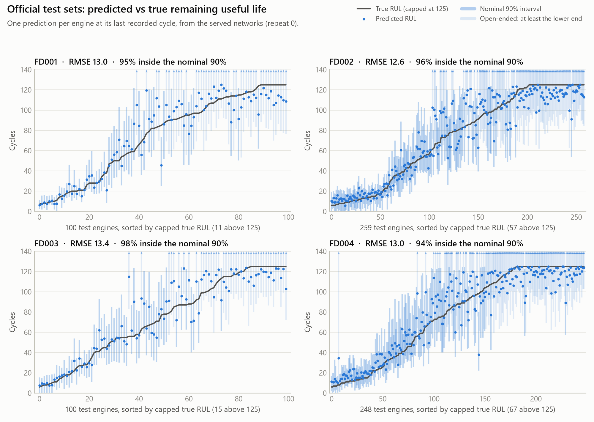
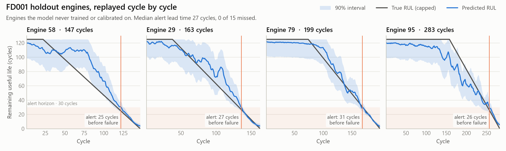
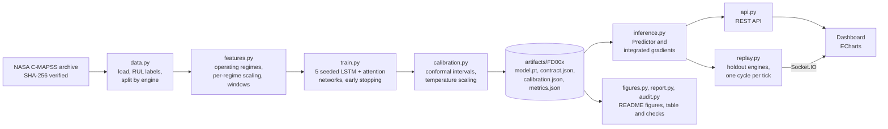

# Turbofan remaining-useful-life prediction, with calibrated uncertainty and explanations

[](https://github.com/easensoy/ml-predictive-maintenance-system/actions/workflows/ci.yml)

[](LICENSE)

How many cycles does this engine have left, how sure is the model, and why? This project
answers all three on NASA's **C-MAPSS** run-to-failure benchmark, and shows them in a live
dashboard that replays engines the model never saw during training.

## What it does

- **Remaining useful life (RUL)** for each engine, with a **nominal 90% interval** from
  conformalized quantile regression. The measured coverage is in the results table; it falls
  short of 90% on three of the four subsets.
- **Probability of failure within 30 cycles**, temperature-scaled on validation engines. It
  drives three states: Healthy, Watch (failure within 30 cycles is inside the interval) and
  Alert (more likely than not).
- **An attribution for every prediction**: integrated gradients assign the predicted RUL to each
  sensor reading in the model's input window, in cycles. They show what the model's output
  depends on, not the physical cause of wear.
- **A live replay**: held-out engines stream cycle by cycle over Socket.IO and the model runs on
  each new cycle, as it would in a streaming deployment.
- **An out-of-distribution flag** on every API prediction whose readings fall outside the range
  the model was trained on.

Every number on this page is generated from the committed artifacts, and
`python -m predmaint.audit` recomputes them from the per-engine predictions.

## Results

These results are **development-exposed**. The window length was chosen on validation engines,
but every candidate's test score was printed at the same time (all 30 runs are in the
[experiment ledger](predictive-maintenance/docs/experiment-ledger.md)), so the test set is not
untouched. Treat the numbers as optimistic.

Each test engine gets one prediction, at its last recorded cycle. The model is trained on RUL
capped at 125 cycles, the usual C-MAPSS target, so a prediction near 125 means "at least about
125 cycles left", not "exactly 125". RMSE and the PHM08 score use the capped truth, as is
standard; "RMSE vs actual RUL" uses NASA's uncapped truth. Alert lead times come from holdout
engines, which run to failure.

<!-- results:start -->
| Subset | Model | RMSE | PHM08 score | RMSE vs actual RUL | Inside nominal 90% interval, capped truth (95% CI) | Inside, actual RUL (95% CI) | Mean interval width | Alert AP | First alert, cycles before failure: median (range) |
|---|---|---:|---:|---:|---:|---:|---:|---:|---:|
| FD001 (100 engines) | LSTM ensemble (5 networks) | 12.89 | **249** | 14.32 | 86% (78–91%) | 78% (69–85%) | 32 cycles | 0.985 | 27 (24–37); 0/15 holdout engines missed |
| FD001 (100 engines) | One LSTM network (mean ± sd over the 5 networks of this ensemble) | 13.44 ± 0.62 | 286 ± 41 | – | – | – | – | – | – |
| FD001 (100 engines) | LightGBM on window statistics (one seed) | **12.52** | 268 | **13.60** | – | – | – | – | – |
| FD002 (259 engines) | LSTM ensemble (5 networks) | 12.48 | 711 | 25.36 | 91% (87–94%) | 70% (64–75%) | 33 cycles | 0.996 | 31 (22–45); 0/39 holdout engines missed |
| FD002 (259 engines) | One LSTM network (mean ± sd over the 5 networks of this ensemble) | 13.05 ± 0.41 | 804 ± 87 | – | – | – | – | – | – |
| FD002 (259 engines) | LightGBM on window statistics (one seed) | **11.54** | **579** | **24.24** | – | – | – | – | – |
| FD003 (100 engines) | LSTM ensemble (5 networks) | 13.19 | 645 | 14.92 | 83% (74–89%) | 69% (59–77%) | 29 cycles | 0.998 | 29 (24–40); 0/15 holdout engines missed |
| FD003 (100 engines) | One LSTM network (mean ± sd over the 5 networks of this ensemble) | 13.76 ± 0.37 | 701 ± 160 | – | – | – | – | – | – |
| FD003 (100 engines) | LightGBM on window statistics (one seed) | **12.47** | **329** | **13.91** | – | – | – | – | – |
| FD004 (248 engines) | LSTM ensemble (5 networks) | **13.06** | **764** | **25.84** | 82% (77–87%) | 60% (54–66%) | 30 cycles | 0.981 | 32 (23–90); 0/37 holdout engines missed |
| FD004 (248 engines) | One LSTM network (mean ± sd over the 5 networks of this ensemble) | 13.78 ± 0.41 | 896 ± 88 | – | – | – | – | – | – |
| FD004 (248 engines) | LightGBM on window statistics (one seed) | 13.48 | 976 | 25.91 | – | – | – | – | – |
<!-- results:end -->

**How to read it.** Bold marks the best model in each subset for that column.
- *Coverage*: the share of test engines whose truth lies inside the interval, with a 95% Wilson
  interval over engines.
- *Actual RUL*: the interval also stops at the 125 cap, so it can never contain an actual RUL
  above 125. That is why coverage of the actual RUL is much lower, especially on FD002 and FD004,
  where many test engines have more than 125 cycles left.
- *Alert AP*: average precision of the failure-within-30-cycles probability on the test engines.
- *One LSTM network*: the spread over the five networks of this one ensemble, not over repeated
  training runs.
- *LightGBM*: trained once, with one seed.
- *Lead time*: measured on only 15 to 39 holdout engines per subset. The range shows that alerts
  are not always inside the 30-cycle horizon: one FD004 engine first alerted 90 cycles before
  failure.

**An honest reading.** On point accuracy, the LightGBM baseline on simple window statistics is
the stronger model: it beats the network on FD001 to FD003 and loses only on FD004. What the
network adds is an interval, an alert probability and a per-reading attribution from one model.
None of these is free of problems. The intervals under-cover on FD003 and FD004 even against the
capped truth. The alert calibration rests on a handful of engines. The attributions have not yet
been validated.

<picture>
  <source media="(prefers-color-scheme: dark)" srcset="predictive-maintenance/docs/figures/results-dark.png">
  
</picture>

<picture>
  <source media="(prefers-color-scheme: dark)" srcset="predictive-maintenance/docs/figures/test-sets-dark.png">
  
</picture>

<picture>
  <source media="(prefers-color-scheme: dark)" srcset="predictive-maintenance/docs/figures/holdout-lives-dark.png">
  
</picture>

<picture>
  <source media="(prefers-color-scheme: dark)" srcset="predictive-maintenance/docs/figures/attribution-dark.png">
  
</picture>

<picture>
  <source media="(prefers-color-scheme: dark)" srcset="predictive-maintenance/docs/figures/alerts-dark.png">
  
</picture>

### Published results, and why they are not directly comparable

The RMSEs below are those listed in Table 4 of Chaoub et al. (2021), next to each study's
protocol. Only Chaoub et al.'s own paper could be read in full; the other three are paywalled, so
their protocol cells say "not checked" rather than guess. The studies differ in the RUL cap, the
engines used for training, the number of runs, the input and, above all, where on each test
trajectory the error is measured. The numbers therefore do not rank these methods against this
project, whose own numbers are in the results table above.

| Study | RUL cap | Training engines | Runs reported | Input | Test error measured at | FD001 | FD002 | FD003 | FD004 |
|---|---|---|---|---|---|---:|---:|---:|---:|
| This project, v2 | 125 | 70% by engine (15% validation, 15% holdout) | one run of a 5-network ensemble | last 50–60 cycles, chosen on validation | last cycle of each test engine | see above | see above | see above | see above |
| MLP-LSTM-MLP, Chaoub et al. (2021) | 130 | 75% by engine, 25% for validation; retraining on all engines not stated | mean of 10 runs | whole trajectory, variable length | every cycle of each test trajectory (their Eq. 4) | 13.26 | 12.49 | 13.11 | 13.97 |
| MS-DCNN, Li et al. (2020) | not checked | not checked | not checked | not checked | not checked | 11.44 | 19.35 | 11.67 | 22.22 |
| DA-CNN, Song et al. (2021) | not checked | not checked | not checked | not checked | not checked | 11.78 | 16.95 | 11.56 | 18.23 |
| HDNN, Al-Dulaimi et al. (2019) | not checked | not checked | not checked | not checked | not checked | 13.02 | 15.24 | 12.22 | 18.15 |

Chaoub et al. report standard deviations over their 10 runs of 0.57, 0.28, 1.28 and 0.48
(Table 3). HDNN's FD001 value is 13.017 in their Table 4, rounded here; they cite the ICASSP 2019
version of HDNN. Chaoub et al. call the Song et al. model DA-CNN; its title calls it a
distributed-attention temporal convolutional network.

## How it works



**Protocol, as it was actually run.**
- Training engines are split **by engine** into train (70%), validation (15%) and holdout
  (15%), so no engine contributes windows to two splits.
- Sensor scaling is fitted on the train split only. FD002 and FD004 mix six flight conditions, so
  readings are clustered into operating regimes and each regime is scaled separately.
- The target is the usual piecewise-linear RUL, capped at 125 cycles.
- The input window length (30, 40, 50 or 60 cycles) was chosen for each subset by validation
  RMSE, with two seeds per candidate. Test scores were printed for every candidate as well.
- Each ensemble member early-stops on validation RMSE. The conformal margin and the alert
  temperature are fitted on **the same validation engines**, so calibration reuses the
  model-selection engines and split-conformal's coverage guarantee does not formally hold.
- Calibration pools every window of each validation engine, while the test set scores one window
  per engine. Overlapping windows are not independent, and long-lived engines weigh more.

**One feature contract.** `features.py` turns raw readings into model windows, and it is saved
next to the model as `contract.json` with a format number and the training range of every
feature. Training, the API and the replay all use this one code path, and a test checks that a
served window equals the training window for the same cycles. (Version 1 of this project broke
exactly there; see [History](#history).) The server refuses to start on a contract, checkpoint
or calibration file it cannot use, and says what to do.

**Model.** A 2-layer LSTM with attention pooling feeds two heads. The first predicts the RUL point
estimate (MSE loss) and its 5th and 95th percentiles (pinball loss), with the bounds placed on
either side of the point by construction so they cannot cross. The second predicts the logit of
failure within 30 cycles. Each output is averaged over 5 seeds.

## Quick start

Requires [uv](https://docs.astral.sh/uv/) (tested with 0.13.7) and Python 3.15, which uv can install.

```bash
cd predictive-maintenance
uv sync                                    # installs dependencies (CPU PyTorch)
uv run python -m predmaint.serve           # dashboard on http://127.0.0.1:5000
```

The trained FD001 model ships in `artifacts/FD001`, so the dashboard works without downloading
anything. To check the published numbers and rebuild the figures from the committed predictions:

```bash
uv run python -m predmaint.audit     # recompute every table value; exit code 1 on a mismatch
uv run python -m predmaint.figures   # rebuild docs/figures from artifacts/
uv run pytest                        # tests use a synthetic dataset, plus the audit above
```

To retrain, download the data first:

```bash
uv run python -m predmaint.data download                      # 12 MB from NASA, checksum-verified
uv run python -m predmaint.train --subset FD001 --window 60   # see metrics.json for each subset's window
uv run python -m predmaint.report                             # rewrite the results tables
```

The published artifacts were trained on a laptop GPU (NVIDIA RTX 1000 Ada) with the CUDA build of
PyTorch 2.15 and `--device cuda`, which takes about a minute per network on FD001. The locked
environment installs CPU PyTorch, which runs the same pipeline about ten times slower; install a
CUDA build from [pytorch.org](https://pytorch.org) to use a GPU. Seeds are not bit-for-bit
reproducible across devices.

Or run it in Docker: gunicorn serves it as a non-root user, and the image includes a health check.

```bash
docker build -t predmaint predictive-maintenance
docker run --rm -p 8000:8000 predmaint             # http://localhost:8000
```

Settings come from `PM_*` environment variables and default to safe values: loopback host, debug
off, same-origin Socket.IO. The full list is in
[`config.py`](predictive-maintenance/src/predmaint/config.py).

## Dashboard

<picture>
  <source media="(prefers-color-scheme: dark)" srcset="predictive-maintenance/docs/figures/dashboard-dark.png">
  
</picture>

## API

| Method | Path | Returns |
|---|---|---|
| GET | `/api/health` | `ok` only if a smoke inference succeeds, otherwise 503 |
| GET | `/api/model-info` | test metrics, baseline, calibration and provenance, from `metrics.json` |
| POST | `/api/predict` | RUL with interval, failure probability, status, per-sensor attribution and an out-of-distribution report |
| GET | `/api/fleet` | current state of every replayed engine |
| GET | `/api/engines/<unit>` | one engine's prediction history, attribution heatmap and sensor traces |

`/api/predict` takes raw cycles, oldest first: the three operational settings and the 14 sensors
the model uses (sensors 2, 3, 4, 7, 8, 9, 11, 12, 13, 14, 15, 17, 20 and 21). Extra keys are
ignored. Short histories are padded, and the response says so. Values must be finite JSON
numbers. If any reading in the model's window lies outside the training range, the response
carries `"out_of_distribution": {"flag": true, ...}` naming the sensors; if the network cannot
produce a finite answer at all, the API returns 422 with the same report.

```bash
curl -s -X POST http://127.0.0.1:5000/api/predict \
     -H "Content-Type: application/json" \
     -d @predictive-maintenance/docs/example-request.json
```

## Project layout

```
predictive-maintenance/
├── src/predmaint/
│   ├── data.py          download, checksums, loading, RUL labels, engine-level split
│   ├── features.py      the feature contract shared by training and serving
│   ├── model.py         LSTM + attention, losses, integrated gradients
│   ├── calibration.py   conformal intervals, temperature scaling
│   ├── metrics.py       RMSE, PHM08 score, coverage, Wilson intervals, calibration, lead time
│   ├── train.py         training CLI
│   ├── inference.py     Predictor: artifacts to calibrated, explained predictions
│   ├── replay.py        live fleet replay of holdout engines
│   ├── api.py           Flask + Socket.IO app; serve.py and wsgi.py run it
│   ├── figures.py       README figures (light and dark)
│   ├── report.py        results tables in README.md and MODEL_CARD.md
│   ├── audit.py         recomputes those tables from the committed predictions
│   ├── templates/, static/   the dashboard
├── tests/               pytest suite on a synthetic dataset in the C-MAPSS file format
├── artifacts/FD00x/     metrics and predictions for every subset; the full FD001 demo model
├── docs/                figures, example request, experiment ledger
├── Dockerfile
└── pyproject.toml, uv.lock
```

## Limitations

- **C-MAPSS is simulated.** It comes from NASA's turbofan simulator, not from field engines. It is
  the standard benchmark for this problem, but good numbers here do not prove field performance.
- **The test set is development-exposed** (see Results and the ledger).
- **Calibration reuses the model-selection engines,** and pools correlated windows, so the
  intervals are nominal rather than guaranteed. They under-cover on three subsets.
- **The interval and the target stop at 125 cycles.** The model cannot say how far beyond 125 an
  engine's life extends.
- **The variance shown is within one ensemble.** The networks share one data split, and
  LightGBM was trained once, so run-to-run variance is not measured.
- **Provenance has a gap.** The published `metrics.json` files record a dirty git tree: the
  training code was committed after training.
- **Single-process demo.** The replay lives in process memory, so it runs with one gunicorn
  worker. The API is read-only, holds no user data and has no authentication.

The [model card](MODEL_CARD.md) covers intended use, out-of-scope uses and known failure modes.

## History

Version 1 of this repository (2025) described a "production-ready" system, but an audit in
November 2026 found that it did not hold up:

- Its data was synthetic.
- Its model could not serve a prediction.
- Its dashboard metrics were hard-coded.
- Its "live sensors" were random numbers.

Version 2 replaces it with the pipeline above. The old code remains in the git history.

## Data, licence and references

- Code: [MIT licence](LICENSE). To cite this software, use [CITATION.cff](CITATION.cff).
- Data: A. Saxena, K. Goebel, D. Simon and N. Eklund, "Damage Propagation Modeling for Aircraft
  Engine Run-to-Failure Simulation", *PHM08*, 2008,
  [doi:10.1109/PHM.2008.4711414](https://doi.org/10.1109/PHM.2008.4711414). Dataset: NASA
  Prognostics Center of Excellence. NASA does not specify a licence for it, so the raw files are
  not redistributed here; `predmaint.data download` fetches them. The rows this repository does
  contain are listed in the [model card](MODEL_CARD.md#data).
- A. Chaoub, A. Voisin, C. Cerisara and B. Iung, "Learning representations with end-to-end models
  for improved remaining useful life prognostics", arXiv:2104.05049, 2021.
- H. Li, W. Zhao, Y. Zhang and E. Zio, "Remaining useful life prediction using multi-scale deep
  convolutional neural network", *Applied Soft Computing* 89, 2020,
  [doi:10.1016/j.asoc.2020.106113](https://doi.org/10.1016/j.asoc.2020.106113).
- Y. Song, S. Gao, Y. Li, L. Jia, Q. Li and F. Pang, "Distributed attention-based temporal
  convolutional network for remaining useful life prediction", *IEEE Internet of Things Journal*
  8(12), 2021, [doi:10.1109/JIOT.2020.3004452](https://doi.org/10.1109/JIOT.2020.3004452).
- A. Al-Dulaimi, S. Zabihi, A. Asif and A. Mohammadi, "Hybrid deep neural network model for
  remaining useful life estimation", *ICASSP*, 2019,
  [doi:10.1109/ICASSP.2019.8683763](https://doi.org/10.1109/ICASSP.2019.8683763).
- Y. Romano, E. Patterson and E. Candès, "Conformalized Quantile Regression", *NeurIPS*, 2019.
- C. Guo, G. Pleiss, Y. Sun and K. Q. Weinberger, "On Calibration of Modern Neural Networks",
  *ICML*, 2017.
- M. Sundararajan, A. Taly and Q. Yan, "Axiomatic Attribution for Deep Networks", *ICML*, 2017.
