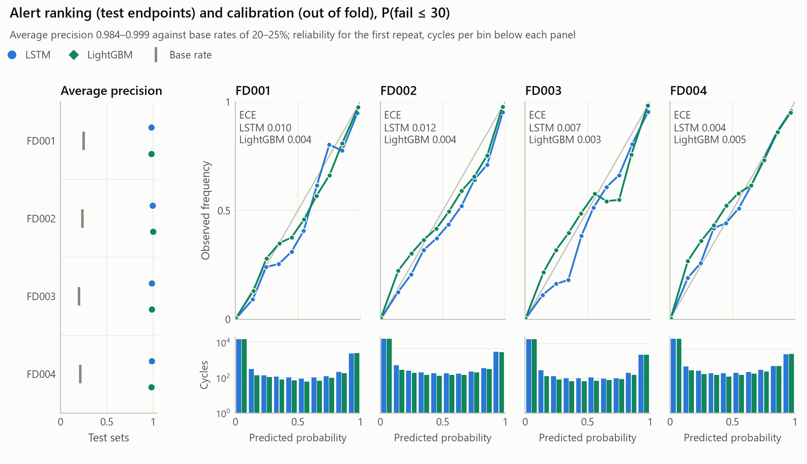
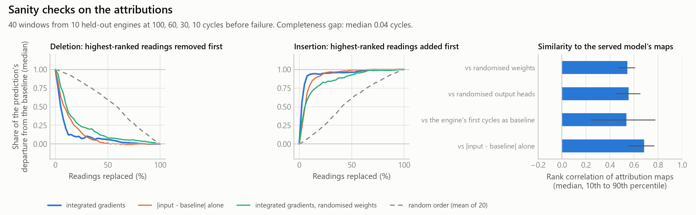
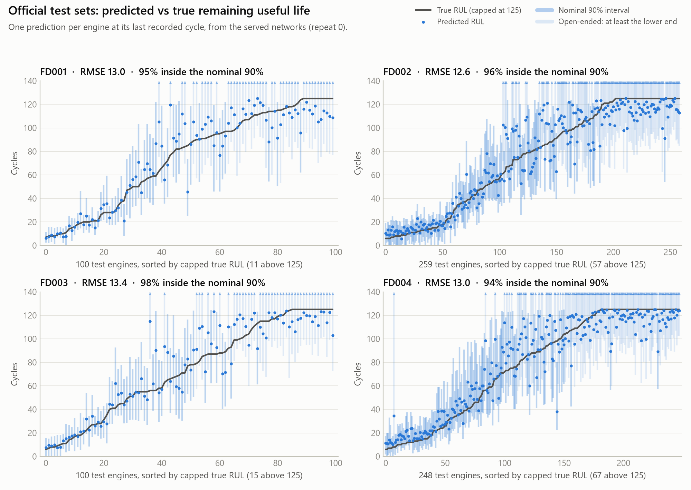
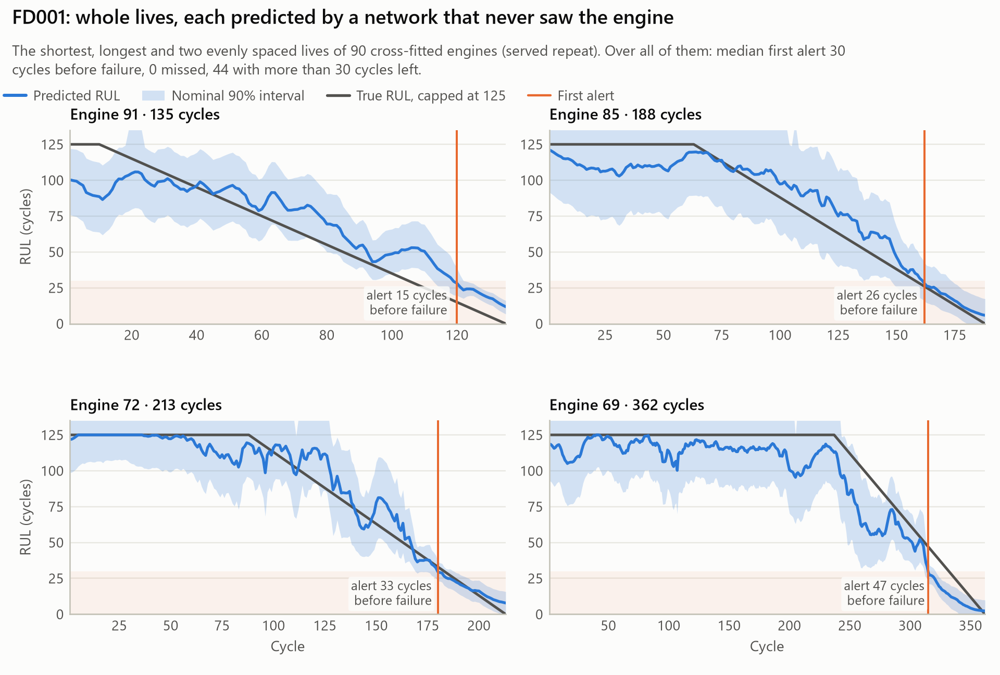

# Evaluation notes

The details behind the [README](../../README.md): conventions, the protocol, the interval
construction and the conditions its guarantee needs, the width statistics, test-set exposure, the
full results, the alert and attribution analyses, published results and the status of every
review finding. Every result here is generated from `artifacts/` by `python -m predmaint.report`
and rechecked by `python -m predmaint.audit`. The audit establishes that these documents agree
with the committed artifacts; the methodological claims are argued below.

## Conventions

| Term | Definition |
|---|---|
| RUL | The number of cycles an engine runs after the current cycle. Known for training engines, which run to failure; NASA gives it for each test engine's last observed cycle. |
| Target, capped RUL | min(RUL, 125). Errors, scores and coverage use it unless "uncapped" is stated. |
| Nominal coverage | The level the interval construction targets: 90%, α = 0.1. |
| Empirical coverage | The share of a population's predictions whose capped RUL lies in the interval. It is marginal, averaged over every engine or cycle in the population, unless stated otherwise. |
| Conditional coverage | Coverage within a band of true RUL. Reported as a diagnostic; nothing here guarantees it. |
| Open-ended interval | An interval whose upper end reaches the cap, reported as [lower, ∞), "at least lower cycles". Because lower ≤ 125, the capped RUL lies in it exactly when the uncapped RUL does. |
| Width statistics | Truncated width, width with both intervals closed, and width over each model's own closed intervals: see [Interval width](#interval-width). |
| Repeat variability | The sample standard deviation (ddof 1) of a statistic over the three repeats, written ±. |
| Bootstrap interval | A 95% percentile interval from 2,000 resamples of the test engines, the same resamples for both models and every repeat. |
| Out-of-fold prediction | A prediction for a cross-fitted engine by the single fold model trained without that engine's fold. |
| First alert, lead time | The first cycle at which the failure probability is at least 0.5 while at least one cycle is left; the lead time is the RUL there. |
| Missed engine | An engine whose alert never fires while at least one cycle is left. |
| First alert with more than 30 (60) cycles left | A first alert before the 30-cycle horizon (or twice it); by the label's definition it is a false alarm when it fires. |
| False-alert episode | The alert coming on, from off or at the first cycle, while more than 30 cycles are left. |
| Switch-off | The alert turning off between consecutive cycles. A late switch-off is one at a cycle with at most 30 cycles left, when the label says the alert should be on. |

## Protocol

**Sampling unit.** The engine. Every partition is by engine, never by row, because consecutive
cycles of one engine are strongly dependent.

**Partitions, per subset.**

1. **Replay holdout.** 10% of the training engines, stratified by life length, are held out once
   (seed 42) and kept fixed across repeats. They are only transformed and predicted. The
   preprocessing is fitted without them (refitting it on the cross-fitted engines alone
   reproduced the committed `contract.json` for FD001 and FD002), and no network, model selection
   or calibration step reads their labels.
2. **Cross-fitting.** The remaining engines are split into five folds: engines are sorted by life
   length and each block of five is dealt to the folds in random order, with a different seed in
   each repeat. Fold model k is trained on the other four folds.
3. **Inner-validation model selection.** Inside those four folds, 15% of the engines, stratified by
   life length, are held out. They choose the input window (30, 40, 50 or 60 cycles, lowest RMSE
   with every engine weighted equally), stop training early and, for the LSTM, drive the
   learning-rate schedule.

**What each engine is used for.** An engine in fold k is never used to train, stop, schedule or
choose the window of fold k's model. It is used for training and inner validation of the other
folds' models, and for the out-of-fold prediction and conformity score of its own.
`predmaint.audit` checks on the committed artifacts that every conformity score and out-of-fold
prediction comes from the model that excluded the engine, that no inner-validation engine comes
from its own fold, and that no replay engine is cross-fitted.

**Shared preprocessing.** One step is not cross-fitted. The operating-setting scaling, the
operating-regime clusters (one regime for FD001 and FD003, k-means with six for FD002 and FD004),
the per-regime sensor scaling and the training ranges used for out-of-distribution flags are
fitted once per subset on the sensor readings, never the labels, of all cross-fitted engines, and
shared by every fold and repeat. Every fold model's inputs therefore depend on the unlabelled
readings of the engines it is calibrated on, but not on any test engine's.

**Calibration.**

- **Intervals.** Each cross-fitted engine is truncated once per repeat, at a length drawn
  uniformly from the official test trajectory lengths shorter than its life. Only the test
  sensor files are read for this; the test labels are not. Its conformity score comes from the
  one fold model that never saw it. The CV+ interval and the conditions its guarantee needs are
  [below](#what-the-conformal-guarantee-covers).
- **Alert probability.** Temperature scaling is fitted out of fold on ten truncations per engine,
  weighting engines equally. The ten points are dependent within an engine; with one scalar
  parameter that matters less than it would for a richer model, but it is not one point per
  engine. The served probability averages the five members' probabilities, each scaled by a
  temperature fitted on single fold models' logits.
- **Alert threshold.** 0.5, fixed before any evaluation and not tuned to any cost.

**Test predictions.** NASA's test trajectories stop before failure. Training reads only their
sensor files: the last window of each engine, which every fold model scores without labels, and
the trajectory lengths. `predmaint.evaluate` alone reads the labels ([Test-set exposure](#test-set-exposure)).

**Repeats and uncertainty.** Each source of uncertainty is measured separately, and no interval
below covers them all.

- **Repeats.** The whole pipeline ran three times. Fold assignment, inner splits, initialisation,
  LightGBM sampling and calibration truncations change between repeats; the replay holdout, the
  preprocessing and the test windows do not. Tables give the mean ± sample sd of the three
  per-repeat statistics. That ± is repeat variability on fixed test engines, not the precision of
  the estimate: for RMSE it is 0.1 to 0.3 cycles, several times narrower than the engine
  bootstrap below, and it omits the variance from the fixed holdout and preprocessing.
- **Model differences.** Repeat-averaged, with a 95% paired bootstrap interval over test engines:
  2,000 resamples (seed 7), each applied to both models and all three repeats, the statistic
  computed per repeat, averaged, then differenced. It measures which engines happen to be in the
  test set, for fixed trained models. It excludes repeat variability and the sampling of training
  engines, and the 16 differences (4 subsets × 4 metrics) are not corrected for multiple
  comparisons.
- **Coverage intervals.** 95% Wilson intervals with n the number of test engines, at the mean
  rate over repeats. They treat engines as independent and cover engine sampling only.

**Populations.**

| Name | What is scored | Model | Used for |
|---|---|---|---|
| Test endpoints | One prediction per official test engine, at its last observed cycle | Each repeat's five-fold ensemble: the mean of the five fold models' points, their CV+ interval and their averaged probability | Accuracy, coverage, open-ended share, width, alert average precision and ECE |
| Out of fold | Every cycle of every cross-fitted engine | The single fold model that never saw the engine; its 5–95% outputs widened by the conformal quantile of the scores of the engines outside its fold, and its probability scaled by a temperature fitted without its fold | Whole-life coverage, alert timing, misses, switch-offs, ECE and reliability |
| Replay holdout | Every cycle of the held-out replay engines | Each repeat's five-fold ensemble, as on the test endpoints; the first repeat's LSTM is deployed | Whole-life statistics of the ensembles, the hero figure, the dashboard and the attribution checks |

RMSE and coverage over whole lives weight engines equally; the open-ended share and ECE pool
cycles. Out-of-fold probabilities come from single fold models, so the out-of-fold alert
statistics describe single networks, not the averaged probability the API serves. The replay
holdout scores the ensemble form, but on only 10 to 26 engines per subset.

### What the conformal guarantee covers

<!-- guarantee:start -->
**Procedure.** Each cross-fitted engine i contributes one conformity score, at one truncation point: the conformalized-quantile-regression score `s_i = max(lo(x_i) − y_i, y_i − hi(x_i))`, where `lo` and `hi` are the 5th and 95th percentile outputs of the fold model trained without engine i's fold and `y_i` is its RUL capped at 125. For a new window x, the lower end is the `⌊α(n + 1)⌋`-th smallest of `lo_k(i)(x) − s_i` over the n calibration engines and the upper end the `⌈(1 − α)(n + 1)⌉`-th smallest of `hi_k(i)(x) + s_i`, where `k(i)` is the fold model that scored engine i and α = 0.1. An upper end at or above the cap is reported as open-ended, [lower, ∞). `predmaint.audit` rebuilds every test interval from the stored scores and raw quantile outputs; that verifies the implementation, not a coverage guarantee.

**The guarantee.** If the n calibration pairs (engine, truncation point) and the test pair are exchangeable, training treats its engines symmetrically and the fold partition is fixed independently of the data, 5-fold CV+ guarantees marginal coverage of at least 1 − 2α − min{2(1 − 1/K)/(n/K + 1), (1 − K/n)/(K + 1)} (Barber et al., 2021, Theorem 4). At α = 0.1 and K = 5 that is below the nominal 90% even when the conditions hold; the 80% often quoted is the jackknife+ bound, K = n.

| Subset | Calibration engines n | Order statistics, lower and upper end | Worst-case CV+ coverage | Calibration points with 125 or more cycles left | Test engines with 125 or more cycles left | Correlation of observed length with total life, calibration / test |
|---|---:|---:|---:|---:|---:|---:|
| FD001 | 90 | 9, 82 | 71.6% | 27% | 11% | 0.16 to 0.30 / 0.65 |
| FD002 | 234 | 23, 212 | 76.7% | 30% | 22% | 0.14 to 0.23 / 0.56 |
| FD003 | 90 | 9, 82 | 71.6% | 40% | 15% | 0.17 to 0.23 / 0.88 |
| FD004 | 224 | 22, 203 | 76.5% | 42% | 27% | 0.26 to 0.31 / 0.81 |

**Conditions this setup does not meet.**

- *Exchangeability.* Calibration truncation points are drawn uniformly from the test trajectory lengths shorter than each engine's life. In NASA's test sets the observed length tracks total life, and in calibration it barely does (last column), so calibration over-represents engines with 125 or more cycles left. The last two columns use the test labels and were computed after they were read.
- *Symmetric training.* The feature scaling and operating-regime clustering are fitted once on the sensor readings of all n cross-fitted engines, so fold model k depends on the covariates of the engines it scores, but not on a test engine's. Training is also symmetric only up to fixed seeds and engine order.
- *Fixed folds.* Folds are formed by sorting engines by life and dealing each block of five at random, so the partition depends on the training data.
- *Marginal coverage only.* Even when it holds, the guarantee averages over engines; it implies nothing about coverage at a given remaining life.

**Consequence.** These are CV+ intervals on CQR scores with nominal 90% coverage. No finite-sample guarantee is claimed for the test sets: the evidence is their empirical coverage, reported with the open-ended share and by remaining life. The calibration mismatch does not explain the over-coverage: in every subset the 90th percentile of the conformity scores is lower at the cap than below it, so over-representing engines at the cap tends to narrow the intervals, the opposite direction; and on test engines with fewer than 125 cycles left, coverage is still 95.3% (LSTM) and 94.0% (LightGBM). The cause of the over-coverage has not been established.
<!-- guarantee:end -->

Establishing a guarantee for these intervals would need a different experiment: preprocessing
fitted inside each fold, or on a set that includes the test inputs symmetrically; a fold partition
fixed independently of the data; and a calibration population exchangeable with the population
the guarantee is claimed for. That requires retraining and is listed under
[open issues](#open-issues-that-need-separate-work), not done here.

### Interval width

<!-- widths:start -->
| Subset | Open-ended intervals | Truncated width, every test engine | Truncated width, LSTM − LightGBM (95% CI) | Engines with both intervals closed | Width on those engines | Width over each model's own closed intervals |
|---|---:|---:|---:|---:|---:|---:|
| FD001 | 45%&nbsp;/&nbsp;39% | **41.5**&nbsp;/&nbsp;46.1 | -4.6 (-7.7 to -1.8) | 52 of 100 | **36.7**&nbsp;/&nbsp;46.4 | **38.1**&nbsp;/&nbsp;47.1 |
| FD002 | 43%&nbsp;/&nbsp;40% | **39.7**&nbsp;/&nbsp;41.6 | -1.9 (-3.4 to -0.5) | 143 of 259 | **37.0**&nbsp;/&nbsp;43.7 | **38.0**&nbsp;/&nbsp;44.3 |
| FD003 | 42%&nbsp;/&nbsp;57% | **37.6**&nbsp;/&nbsp;58.0 | -20.4 (-26.5 to -14.9) | 42 of 100 | **35.4**&nbsp;/&nbsp;74.1 | **38.5**&nbsp;/&nbsp;73.8 |
| FD004 | 50%&nbsp;/&nbsp;62% | **43.1**&nbsp;/&nbsp;56.0 | -12.9 (-16.0 to -10.1) | 90 of 248 | **38.9**&nbsp;/&nbsp;73.4 | **45.6**&nbsp;/&nbsp;73.3 |

Widths in cycles; each cell is LSTM / LightGBM, the mean over 3 repeats, on the official test endpoints. An open-ended interval is [lower, ∞): its upper end reached the 125-cycle cap, so it has no finite width. Read instead as closed at the cap, [lower, 125], the same intervals would contain the actual, uncapped RUL of only 67 to 84% of test engines (a statistic defined before the test labels were read), so every coverage figure in these notes depends on the open-ended reading.

- **Truncated width** counts an open-ended interval as 125 minus its lower end. It measures both models on every engine, but it summarises the truncated interval, not the prediction set. It was defined after the test labels were read, with a paired engine-level bootstrap interval for the difference.
- **Width with both intervals closed** averages upper minus lower over the engines on which neither model's interval is open-ended, per repeat. It compares the models on the same engines, but only on engines whose predicted upper end stays below the cap. It was also defined after the test labels were read.
- **Width over each model's own closed intervals** (`closed_width` in `metrics.json`) was defined in the evaluated code before the test labels were read. It averages over a different set of engines for each model.

The LSTM's mean width is lower under all three statistics on every subset.
<!-- widths:end -->

The pre-registered statistic was the width over each model's own closed intervals: it was the
width column of the README generated by the evaluated code. The truncated width replaced it as
the headline after the test labels were read, because it measures both models on the same
engines. All three statistics are reported, and the comparison holds under each.

### Test-set exposure

Three levels of exposure are distinguished.

- **Development exposure.** During version 2's development, on 6 November 2026, every training
  run printed test-set RMSE, coverage and alert AP. The window grid was explored, input smoothing
  was tried and dropped, and two calibration variants were tried and dropped, with those scores
  visible; the [experiment ledger](experiment-ledger.md) lists every run. The architecture and
  optimiser settings were set before those runs and carried into the final pipeline unchanged,
  but the final protocol was designed by people who had seen test scores.
- **The final evaluation event.** The cross-fitted pipeline's training reads no test labels.
  `predmaint.evaluate` read them once per subset, between 7 November 22:18 and 8 November 01:35
  (UTC), for runs trained from one clean commit, `a1b69ff`, and the ledger records each event.
  Every statistic in `metrics.json` was defined in that commit. The labels are then stored in the
  committed prediction files (`rul_true`), so every later report, figure, gallery and audit run
  reads them again; the ledger records evaluation events, not those reads.
- **Untouched evaluation.** None exists in this repository. Every C-MAPSS engine, in the training
  and the test files, was used during development, so one final evaluation event does not make
  the test sets an independent holdout. Re-evaluating on any other part of C-MAPSS would not
  restore independence either; an independent estimate would need data that no development step
  used.

### Summaries defined after the test labels were read

The statistics in `metrics.json` were defined in the code of commit `a1b69ff` before that code
read the test labels: RMSE, the PHM08 score, RMSE against the uncapped truth, coverage, coverage
under the closed reading, the open-ended share, the width over each model's own closed intervals,
alert average precision, ECE, the out-of-fold alert statistics and the replay-holdout statistics
(the last first reported in this revision). The summaries below were defined afterwards, while
writing the documents. They are descriptive, use no new model output, and are labelled where
they appear:

- the truncated width and its bootstrap intervals (commit `0ecb0ce`), which also replaced the
  pre-registered width as the headline;
- the failure-case gallery's error slices (`adae7d2`);
- coverage by true remaining life, pooled coverage and the RMSE of single fold models (`958062a`
  and later);
- the width with both intervals closed, switch-offs in the last 30 cycles, and the test engines'
  share with 125 or more cycles left in the guarantee table (`8be907d`);
- the correlation of observed length with total life and the coverage on test engines with fewer
  than 125 cycles left, both in the guarantee section, and the share of open-ended intervals by
  band of true RUL in the uncertainty figure (added after release 220ab9b);
- every figure, all drawn after the evaluation event.

## Full results

The README's compact table summarises these.

<!-- results:start -->
**Official test endpoints.** One prediction per test engine, at its last observed cycle. Each repeat of each model is evaluated as its five-fold ensemble: the point prediction is the mean of the five fold models and the interval is their CV+ interval. The API and dashboard serve the first repeat's LSTM ensemble. Entries are mean ± sample sd over 3 repeats on the same test engines; the ± is repeat variability (fold assignment, inner-validation splits, initialisation and calibration truncation; the replay holdout and the preprocessing are fixed), not the precision of the estimate. Bold marks the better model in each subset. RMSE is against the true RUL capped at 125 cycles; RMSE against the uncapped RUL scores the same capped predictions, so it includes the error the cap imposes on engines with more than 125 cycles left. Coverage is the empirical, marginal share of test engines whose capped RUL lies in the interval, an open-ended interval counting as [lower, ∞); its 95% Wilson interval takes n = test engines at the repeat-mean rate and covers engine sampling only. Width truncates open-ended intervals at the cap, a summary defined after the test labels were read; the evaluation notes give two other width statistics.

| Subset | Model | RMSE | PHM08 score | RMSE vs uncapped RUL | Empirical coverage, nominal 90% (95% CI) | Open-ended intervals | Mean width, open-ended truncated at the cap | Alert AP | Alert ECE |
|---|---|---:|---:|---:|---:|---:|---:|---:|---:|
| FD001 (100 engines) | LSTM | 12.94 ± 0.11 | 306 ± 17 | 14.28 ± 0.14 | 95.3 ± 0.6% (89–98%) | 45 ± 2% | 41.5 ± 1.4 cycles | 0.984 ± 0.004 | 0.045 ± 0.007 |
| FD001 (100 engines) | LightGBM | **12.11 ± 0.24** | **244 ± 3** | **13.36 ± 0.21** | 95.0 ± 1.0% (89–98%) | 39 ± 3% | 46.1 ± 2.7 cycles | **0.984 ± 0.002** | 0.044 ± 0.003 |
| FD002 (259 engines) | LSTM | 12.53 ± 0.11 | 643 ± 43 | 25.27 ± 0.37 | 96.4 ± 0.2% (94–98%) | 43 ± 2% | 39.7 ± 0.8 cycles | 0.996 ± 0.002 | 0.029 ± 0.000 |
| FD002 (259 engines) | LightGBM | **11.47 ± 0.10** | **571 ± 13** | **24.04 ± 0.08** | 95.6 ± 1.2% (93–98%) | 40 ± 4% | 41.6 ± 2.5 cycles | **0.999 ± 0.000** | 0.021 ± 0.002 |
| FD003 (100 engines) | LSTM | 13.22 ± 0.26 | 610 ± 55 | 14.90 ± 0.15 | 94.7 ± 3.1% (89–98%) | 42 ± 1% | 37.6 ± 2.9 cycles | **0.987 ± 0.001** | 0.031 ± 0.010 |
| FD003 (100 engines) | LightGBM | **12.03 ± 0.15** | **281 ± 12** | **13.63 ± 0.16** | 95.0 ± 3.0% (89–98%) | 57 ± 15% | 58.0 ± 11.3 cycles | 0.986 ± 0.006 | 0.031 ± 0.007 |
| FD004 (248 engines) | LSTM | **12.82 ± 0.29** | **737 ± 48** | 25.75 ± 0.06 | 95.8 ± 1.3% (93–98%) | 50 ± 0% | 43.1 ± 1.8 cycles | **0.985 ± 0.002** | 0.025 ± 0.004 |
| FD004 (248 engines) | LightGBM | 13.11 ± 0.15 | 905 ± 34 | **25.41 ± 0.11** | 94.2 ± 0.2% (91–97%) | 62 ± 5% | 56.0 ± 3.5 cycles | 0.984 ± 0.002 | 0.012 ± 0.004 |

**Paired differences, LSTM minus LightGBM, on the same test engines.** Repeat-averaged difference with a 95% percentile interval from a paired engine-level bootstrap: 2,000 resamples of the test engines, each applied to both models and every repeat. It reflects which engines are in the test set, for the trained models; it excludes repeat variability, and the 16 intervals are not corrected for multiple comparisons.

| Subset | RMSE, LSTM minus LightGBM | PHM08 score, LSTM minus LightGBM | Coverage, LSTM minus LightGBM (points) | Interval width, LSTM minus LightGBM |
|---|---:|---:|---:|---:|
| FD001 | +0.83 (-0.70 to +2.39) | +62 (-22 to +180) | +0.3 (-2.3 to +3.0) | -4.6 (-7.7 to -1.8) |
| FD002 | +1.06 (+0.26 to +1.93) | +72 (-42 to +190) | +0.8 (-1.4 to +3.1) | -1.9 (-3.4 to -0.5) |
| FD003 | +1.19 (-0.50 to +3.25) | +329 (-53 to +1048) | -0.3 (-4.0 to +3.7) | -20.4 (-26.5 to -14.9) |
| FD004 | -0.30 (-1.04 to +0.46) | -168 (-438 to +14) | +1.6 (-0.9 to +4.2) | -12.9 (-16.0 to -10.1) |

**Alerts over whole lives, out of fold.** Every cycle of every cross-fitted training engine, each predicted by the single fold model that never saw it, not by an ensemble. The alert fires when the probability of failure within 30 cycles reaches 0.5. Engine counts are means ± sd over repeats; the ECE interval is the repeat-averaged 95% bootstrap interval over engines.

| Subset | Model | Engines | First alert, median cycles before failure | Missed | First alert with more than 30 cycles left | False-alert episodes per engine | Switch-offs before failure per engine | ECE over all cycles (95% CI) |
|---|---|---:|---:|---:|---:|---:|---:|---:|
| FD001 | LSTM | 90 | 30 ± 1 | 0.0 ± 0.0 | 42.7 ± 3.2 | 0.48 ± 0.04 | 0.02 ± 0.01 | 0.008 ± 0.002 (0.006–0.013) |
| FD001 | LightGBM | 90 | 30 ± 0 | 0.0 ± 0.0 | 42.7 ± 1.5 | 0.61 ± 0.07 | 0.39 ± 0.06 | 0.005 ± 0.003 (0.004–0.009) |
| FD002 | LSTM | 234 | 30 ± 2 | 0.0 ± 0.0 | 111.3 ± 18.2 | 0.52 ± 0.10 | 0.15 ± 0.03 | 0.009 ± 0.003 (0.006–0.012) |
| FD002 | LightGBM | 234 | 30 ± 0 | 0.0 ± 0.0 | 110.3 ± 2.5 | 0.62 ± 0.04 | 0.36 ± 0.03 | 0.005 ± 0.001 (0.004–0.007) |
| FD003 | LSTM | 90 | 30 ± 1 | 0.0 ± 0.0 | 40.7 ± 6.7 | 0.47 ± 0.08 | 0.11 ± 0.02 | 0.008 ± 0.002 (0.005–0.012) |
| FD003 | LightGBM | 90 | 30 ± 0 | 0.0 ± 0.0 | 43.7 ± 1.5 | 0.61 ± 0.03 | 0.33 ± 0.06 | 0.004 ± 0.001 (0.003–0.007) |
| FD004 | LSTM | 224 | 31 ± 1 | 1.7 ± 1.5 | 110.0 ± 8.2 | 0.53 ± 0.05 | 0.12 ± 0.02 | 0.005 ± 0.001 (0.003–0.010) |
| FD004 | LightGBM | 224 | 30 ± 0 | 0.0 ± 0.0 | 105.7 ± 2.3 | 0.65 ± 0.01 | 0.49 ± 0.01 | 0.004 ± 0.001 (0.003–0.008) |

**The ensembles over whole lives: replay holdout.** Every cycle of the held-out replay engines, which no network, preprocessing or calibration step used, predicted by each repeat's five-fold ensemble, the form the API serves (only the first repeat's LSTM is deployed). Definitions as above; RMSE and coverage weight engines equally. With 10 to 26 engines per subset, the alert counts are small.

| Subset | Model | Engines | RMSE, every cycle | Empirical coverage, every cycle | Open-ended intervals | First alert, median cycles before failure | Missed | First alert with more than 30 cycles left | Switch-offs before failure per engine |
|---|---|---:|---:|---:|---:|---:|---:|---:|---:|
| FD001 | LSTM | 10 | 11.22 ± 0.28 | 98.3 ± 1.5% | 57 ± 1% | 30 ± 1 | 0.0 ± 0.0 | 4.7 ± 0.6 | 0.00 ± 0.00 |
| FD001 | LightGBM | 10 | 8.82 ± 0.24 | 94.4 ± 1.6% | 53 ± 2% | 30 ± 0 | 0.0 ± 0.0 | 5.0 ± 0.0 | 0.17 ± 0.12 |
| FD002 | LSTM | 26 | 14.53 ± 0.20 | 93.5 ± 0.5% | 56 ± 1% | 31 ± 1 | 0.0 ± 0.0 | 13.0 ± 2.6 | 0.13 ± 0.08 |
| FD002 | LightGBM | 26 | 13.29 ± 0.09 | 90.3 ± 2.2% | 53 ± 4% | 30 ± 0 | 0.0 ± 0.0 | 11.3 ± 0.6 | 0.31 ± 0.07 |
| FD003 | LSTM | 10 | 11.47 ± 0.61 | 96.7 ± 1.7% | 63 ± 2% | 30 ± 1 | 0.0 ± 0.0 | 5.0 ± 1.0 | 0.00 ± 0.00 |
| FD003 | LightGBM | 10 | 11.69 ± 0.26 | 92.9 ± 3.0% | 73 ± 10% | 30 ± 1 | 0.0 ± 0.0 | 4.0 ± 1.0 | 0.17 ± 0.15 |
| FD004 | LSTM | 25 | 12.41 ± 0.15 | 96.7 ± 0.4% | 65 ± 1% | 30 ± 2 | 0.0 ± 0.0 | 10.3 ± 3.5 | 0.09 ± 0.08 |
| FD004 | LightGBM | 25 | 11.80 ± 0.09 | 94.4 ± 0.7% | 74 ± 3% | 29 ± 1 | 0.0 ± 0.0 | 11.0 ± 0.0 | 0.27 ± 0.05 |
<!-- results:end -->

### Findings in detail

<!-- summary:start -->
- **Point accuracy.** LightGBM's test RMSE is lower on 3 of 4 subsets; the paired difference (LSTM minus LightGBM) excludes zero only on FD002, +1.06 cycles (95% CI +0.26 to +1.93). The LSTM is lower on FD004, -0.30 cycles (95% CI -1.04 to +0.46). Averaging the five fold models lowers RMSE by 0.5 to 1.1 cycles relative to the mean single fold model, for both families.
- **Intervals.** Empirical coverage of the nominal 90% intervals is 94 to 96% per subset and model, with 39 to 62% of intervals open-ended. It is marginal coverage: by true remaining life it falls to 91% for the LSTM (76–100 cycles left) and 81% for LightGBM (51–75 cycles left). Out of fold, over whole lives, where each single fold model's quantiles are widened by the conformal quantile of the other folds' scores, it is 88 to 93%, below nominal for LightGBM on FD001 and FD002 and the LSTM on FD003. The LSTM's mean width is lower under all three width statistics on every subset ([Interval width](#interval-width)).
- **Alerts.** *Ranking* (test endpoints): average precision 0.984 to 0.999 against base rates of 20 to 25%. *Threshold decisions* (out of fold): the first alert comes a median 30 to 31 cycles before failure; 48% (LSTM) and 47% (LightGBM) of first alerts come with more than 30 cycles left, false alarms at that moment by the label's definition, and 97% and 98% of those with at most 60; the LSTM alone misses engines (1.7 of 224 FD004 engines per repeat). *Temporal stability* (out of fold): the alert switches off before failure 0.02 to 0.15 times per engine for the LSTM and 0.33 to 0.49 for LightGBM, or 0.01 to 0.07 against 0.16 to 0.24 counting only switch-offs in the last 30 cycles. With the five-fold ensembles on the replay holdout, switch-offs are 0.00 to 0.13 against 0.17 to 0.31 per engine. *Calibration* is reported separately, as ECE in the tables and as reliability diagrams below.
<!-- summary:end -->

### Alert ranking and calibration

<picture>
  <source media="(prefers-color-scheme: dark)" srcset="figures/alert-calibration-dark.png">
  
</picture>

- **Ranking.** Average precision is computed on the test endpoints from the ensembles'
  probability of failure within 30 cycles, with an engine positive when it fails within 30 cycles
  of its last observed cycle. It measures how well the probability ranks engines, not whether it
  is right; a random score would get the base rate.
- **Calibration.** ECE uses ten equal-width probability bins. On the test endpoints it scores the
  ensembles, one point per engine; out of fold it scores single fold models at every cycle, with
  intervals from resampling whole engines, since consecutive cycles of one engine are dependent.
  ECE weights each bin by its share of predictions, and most cycles have a probability below 0.1,
  so it says little about calibration near the 0.5 threshold. The reliability diagrams, out of
  fold for the first repeat, show each bin with its count.
- **Threshold decisions and temporal stability** are the lead time, missed engines, early first
  alerts and switch-offs in the tables above. They describe one fixed threshold; no cost of
  early, late or missed alerts is modelled, so they rank the alerts' behaviour, not their
  operational value.

## Attribution checks

`predmaint.attribution_checks` writes `artifacts/FD001/attribution-checks.json`. It tests the
integrated-gradients maps of the served FD001 ensemble on held-out replay engines:

- completeness, at the served 48 integration steps and at 256;
- deletion and insertion curves for attribution order against random order (20 orders), input
  deviation from the reference, and the attributions of a network with re-initialised weights
  (Adebayo et al., 2018);
- rank correlations with the maps of a re-initialised network, with input deviation, and with
  attributions against a different reference: each engine's own mean over its first cycles.

<!-- attribution:start -->
**Scope.** Integrated gradients (IG) of the served FD001 ensemble's point prediction, relative to a reference window in which every scaled reading equals its operating regime's training mean, with 48 integration steps. 40 windows: the 10 FD001 replay engines at 100, 60, 30 and 10 cycles before failure. One trained ensemble from one seed; each statistic is a median or a count over windows, with no confidence interval, and there is no ground truth for which readings matter.

- **Completeness, a numerical check.** IG satisfies completeness by construction, so the gap between the attributions' sum and the prediction's change from the reference tests only the path-integral approximation: median 0.04 cycles against a median change of 69 cycles, with a worst window of 5.72 cycles (0.19 with 256 steps).
- **Deletion and insertion, perturbation sensitivity.** Readings are replaced by their reference values in order of attribution magnitude, and the prediction's normalised departure from the reference is averaged over the replacement fractions (lower is better for deletion, higher for insertion). In the median window IG beats random order (deletion area 0.097 against 0.557; better in 32 of 40 windows) and a re-initialised network's IG (0.190; better in 32 of 40).
- **The tail.** The medians hide poor windows: 5 of 40 have a deletion area above 1, where partial replacement moves the prediction further from the reference than the full window does, and the mean deletion area is 0.591 against 0.565 for random order. At 100 cycles before failure, where the median change is 7.7 cycles, IG loses to random order in 7 of 10 windows.
- **Input deviation, a negative comparison.** Ranking readings by their distance from the reference alone gives a median deletion area of 0.132 and insertion area of 0.923, against IG's 0.097 and 0.935. IG beats it in 26 of 40 windows on deletion and 18 of 40 on insertion, and the two maps have a median rank correlation of 0.68.
- **Weight randomisation.** Re-initialising every weight, or only the output heads, gives maps with median rank correlations of 0.55 and 0.56 to the trained maps.
- **Reference sensitivity.** With each engine's own mean over its first cycles as the reference instead of the regime mean, the maps change: median rank correlation 0.54, and 2 of the top 3 sensors kept.
<!-- attribution:end -->

**Interpretation.** In the median window, attribution order identifies readings to which the
prediction is sensitive better than random order or a re-initialised network does. It does
little better than ranking readings by their distance from the reference, it fails in a minority
of windows, especially far from failure where the prediction barely departs from the reference,
and it depends on the reference chosen. The maps are best read as model-weighted input deviation
from the regime mean.

Limits of these checks:

- completeness holds by construction, so it only checks the numerical integration; it is not
  evidence of faithfulness;
- the deletion and insertion curves splice reference values into real windows, which produces
  inputs unlike any the model was trained on, so they measure perturbation sensitivity off the
  data distribution;
- the windows come from the replay engines of one subset, for one trained ensemble, with no
  confidence intervals;
- correlated sensors share credit, and the maps change with the reference;
- nothing here is a ground truth for which readings matter, or shows that a sensor causes the
  predicted degradation;
- provenance: `attribution-checks.json` records neither a commit nor a source hash and is not in
  the manifest, and its file time predates the commit of its code. Rerunning the committed code
  on 8 November 2026 reproduced every number in it exactly.

<picture>
  <source media="(prefers-color-scheme: dark)" srcset="figures/attribution-checks-dark.png">
  
</picture>

## Published results

The RMSEs below are those listed in Table 4 of Chaoub et al. (2021), next to each study's
protocol.

- **Not checked.** Only Chaoub et al.'s own paper could be read in full; the other three are
  paywalled, so their protocol cells say "not checked" rather than guess.
- **Not comparable.** The studies differ in the RUL cap, the engines used for training, the number
  of runs, the input and, above all, where on each test trajectory the error is measured. The
  numbers therefore do not rank these methods against this project, and they are not drawn on the
  same axes as its results.

| Study | RUL cap | Training engines | Runs reported | Input | Test error measured at | FD001 | FD002 | FD003 | FD004 |
|---|---|---|---|---|---|---:|---:|---:|---:|
| This project | 125 | 90%, cross-fitted in 5 folds by engine; 10% held out for the replay | mean of 3 repeats of a 5-model average | last 30–60 cycles, chosen per fold on inner-validation engines | last cycle of each test engine | see [Full results](#full-results) | see [Full results](#full-results) | see [Full results](#full-results) | see [Full results](#full-results) |
| MLP-LSTM-MLP, Chaoub et al. (2021) | 130 | 75% by engine, 25% for validation; retraining on all engines not stated | mean of 10 runs | whole trajectory, variable length | every cycle of each test trajectory (their Eq. 4) | 13.26 | 12.49 | 13.11 | 13.97 |
| MS-DCNN, Li et al. (2020) | not checked | not checked | not checked | not checked | not checked | 11.44 | 19.35 | 11.67 | 22.22 |
| DA-CNN, Song et al. (2021) | not checked | not checked | not checked | not checked | not checked | 11.78 | 16.95 | 11.56 | 18.23 |
| HDNN, Al-Dulaimi et al. (2019) | not checked | not checked | not checked | not checked | not checked | 13.02 | 15.24 | 12.22 | 18.15 |

Notes on the table:
- Chaoub et al. report standard deviations over their 10 runs of 0.57, 0.28, 1.28 and 0.48
  (Table 3).
- HDNN's FD001 value is 13.017 in their Table 4, rounded here; they cite the ICASSP 2019 version of
  HDNN.
- Chaoub et al. call the Song et al. model DA-CNN; its title calls it a distributed-attention
  temporal convolutional network.

References:
- A. Chaoub, A. Voisin, C. Cerisara and B. Iung, "Learning representations with end-to-end models
  for improved remaining useful life prognostics", arXiv:2104.05049, 2021.
- H. Li, W. Zhao, Y. Zhang and E. Zio, "Remaining useful life prediction using multi-scale deep
  convolutional neural network", *Applied Soft Computing* 89, 2020,
  [doi:10.1016/j.asoc.2020.106113](https://doi.org/10.1016/j.asoc.2020.106113).
- Y. Song, S. Gao, Y. Li, L. Jia, Q. Li and F. Pang, "Distributed attention-based temporal
  convolutional network for remaining useful life prediction", *IEEE Internet of Things Journal*
  8(12), 2021, [doi:10.1109/JIOT.2020.3004452](https://doi.org/10.1109/JIOT.2020.3004452).
- A. Al-Dulaimi, S. Zabihi, A. Asif and A. Mohammadi, "Hybrid deep neural network model for
  remaining useful life estimation", *ICASSP*, 2019,
  [doi:10.1109/ICASSP.2019.8683763](https://doi.org/10.1109/ICASSP.2019.8683763).

## More figures

**Every test engine.** One prediction per engine at its last recorded cycle, with its interval.
Engines with true RUL above 125 sit on the plateau at the right. This is the population that the
test tables score.

<picture>
  <source media="(prefers-color-scheme: dark)" srcset="figures/test-sets-dark.png">
  
</picture>

**Whole lives, out of fold.** How the prediction, the interval and the alert behave over an
engine's whole life, for engines the predicting network never saw.

<picture>
  <source media="(prefers-color-scheme: dark)" srcset="figures/lives-dark.png">
  
</picture>

## Status of the last review's findings

The review covered commit `3048740`, version 2. Each finding was rechecked against the released
branch.

| Finding | Status | Evidence |
|---|---|---|
| The public `master` branch still advertises the legacy project. | **Fixed.** Pull request [#1](https://github.com/easensoy/ml-predictive-maintenance-system/pull/1) merged the rebuild into `master` on 8 November 2026, after CI passed. | The repository's front page |
| Validation engines chose the model and also calibrated it. | **Fixed.** Window choice and early stopping use inner-validation engines inside each fold, and every calibration score comes from the fold model that never saw the engine. | `predmaint.audit` checks both rules on the committed predictions |
| Calibration pooled dependent windows, while testing uses one endpoint per engine. | **Fixed for the intervals**, which use one truncation point per engine drawn from the test trajectory lengths. **Partly open for the alert temperature**, which uses ten truncations per engine. | Protocol above |
| The prose contradicted itself about evaluating the test set once. | **Fixed.** Each test set was scored once by the final pipeline, and the earlier development exposure is stated. | [Test-set exposure](#test-set-exposure), the experiment ledger |
| Holdout prediction files existed locally but were not committed. | **Fixed.** Every prediction file that the figures and the audit read is tracked. The FD002 to FD004 networks and replay rows are not tracked, but their hashes are in each `manifest.json`. | `git ls-files predictive-maintenance/artifacts` |
| The figure command could not rebuild every figure from a clean clone. | **Fixed.** `python -m predmaint.figures` needs only tracked files; CI runs it from a clean checkout. | CI step "Rebuild the figures" |
| Recorded source hashes did not identify a commit. | **Fixed.** All four `metrics.json` files name commit `a1b69ff` with clean sources, and `source_sha256` recomputed from that commit's tree matches. | `provenance` in each `metrics.json` |
| The alerts figure clipped a caption. | **Fixed.** All figures were redrawn at README width, and their subtitles wrap to it. | `docs/figures/` |
| The ensemble was bolded even where LightGBM had the lower RMSE. | **Fixed.** Bold marks the better model in each column of each subset. | The results tables |

## Corrections from the pre-release methodology review

Before release, the code and artifacts were reviewed against every claim in these documents. The
review confirmed the engine separation, the CV+ implementation and the provenance of the training
and evaluation code. It also found wording that went beyond the evidence, corrected then:

- **The CV+ guarantee** was stated as 1 − 2α = 80%, which is the jackknife+ bound. The five-fold
  bound is lower, and the test sets do not meet its assumptions.
- **"First alert more than 30 cycles early"** counted first alerts with more than 30 cycles left,
  that is, any first alert before the horizon. The tables and figures now say so.
- **"Served five-model average"** described the test evaluation inexactly: each repeat is evaluated
  as a five-fold ensemble with a CV+ interval, and only the first repeat's LSTM is served.
- **The attribution checks** were summarised by their medians as showing faithful attributions.
- **The shared preprocessing** and the **summaries defined after the test labels were read** were
  not disclosed.
- **The ± in the tables** was not said to be repeat variability rather than precision, and the
  bootstrap intervals were not said to be uncorrected for multiple comparisons.

## Corrections in this revision

A second review of the code and artifacts, against the documents released in commit `220ab9b`,
corrected these claims:

- **The cause of the test over-coverage.** The open issues said the calibration population's
  remaining-life mix produces the over-coverage on the test sets. The evidence points the other
  way: calibration over-represents engines at the cap, whose conformity scores are lower, which
  tends to narrow the intervals, and coverage stays above nominal on test engines below the cap.
  The cause is now reported as not established.
- **Why the calibration mix differs.** NASA's test observation lengths track total life, while
  the calibration truncations drawn from them barely do; this is now shown in the guarantee table.
- **The conformal guarantee.** The intervals are now described as CV+ intervals on CQR scores with
  nominal coverage, the construction is stated exactly, and each unmet condition is named,
  including the data-dependent fold partition and the preprocessing's asymmetry between
  calibration and test engines.
- **The width comparison.** Three width statistics are now tabulated with their populations. The
  headline width was switched from the pre-registered statistic after the test labels were read,
  which is now disclosed, and the coverage of the same intervals read as closed at the cap is
  reported.
- **Restoring independence.** The open issues proposed a held-out set of C-MAPSS training engines
  as a clean final estimate. Every training engine was used during development, so that would not
  restore independence; the claim is withdrawn.
- **The out-of-fold intervals** were described as using each fold model's "own" conformal margin.
  The margin is the conformal quantile of the scores of the engines outside the fold.
- **Alerts.** The deployed form's whole-life statistics, on the replay holdout, are now reported
  next to the single fold models', and the share of first alerts that are false alarms by the
  label's definition is given wherever switch-offs are compared.
- **Attributions.** The tail is now quantified: the mean deletion area is worse than random
  order's, and far from failure attribution order loses to random in most windows. The scope, the
  reference input and the provenance of `attribution-checks.json` are stated.
- **The uncertainty figure** labelled out-of-fold coverage as a share of cycles; it weights
  engines equally. Its width panel no longer calls narrower intervals "sharper".
- **The notes harness.** The optional model side has never run; it is now described as a harness
  with template-only results.

## Open issues that need separate work

These go beyond presentation. They need a new evaluation design, retraining, or data outside
C-MAPSS.

- **A coverage guarantee.** One would need preprocessing fitted inside each fold, or fitted
  symmetrically on calibration and test inputs; a fold partition fixed independently of the
  data; and calibration points exchangeable with the population of interest. Matching NASA's
  truncation mechanism would mean modelling how observed length depends on life.
- **Conditional coverage.** Coverage falls below nominal in mid-life. Calibrating conditionally,
  for example on predicted RUL, needs retraining and re-evaluation.
- **The cause of the over-coverage** on the test endpoints is not established.
- **The served alert probability.** Its temperature was fitted for single fold models out of fold.
  Calibrating the averaged probability needs engines that none of the five fold models saw.
- **Uncertainty from training.** The difference intervals cover test-engine sampling only. Repeat
  variability would need more repeats and a two-level bootstrap, and the fixed holdout and
  preprocessing were never resampled.
- **Alert utility.** No cost of early, late or missed alerts is modelled, and the threshold is not
  tuned to one. Splitting switch-offs at the horizon, as the last-30-cycle count does, is a post
  hoc definition.
- **Development exposure.** Every C-MAPSS engine was used during development. An independent
  estimate needs data that no development step touched; no further evaluation on C-MAPSS can
  provide one.
- **The window grid.** 60 cycles, the longest window, won most folds. Longer windows were not tried.
- **The attribution checks.** One subset, one trained ensemble and no confidence intervals; a
  sensor-level ground truth does not exist for C-MAPSS.
- **Reproducibility across devices.** GPU training is not bit-for-bit reproducible, so a rerun
  reproduces the protocol, not the exact numbers.
- **History.** The branch is merged with its history intact, so version 1 is still in it.
  Version 1's ThingSpeak keys are in that history, but the owner rotated them before this release
  (confirmed on 8 November 2026), so they no longer work. Commit `a1b69ff` also holds a local
  scratch path in one ledger line, which a later commit corrects.
