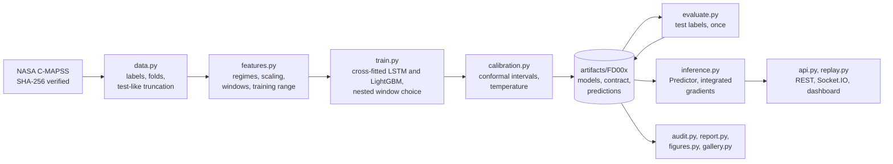

# Serving: dashboard, API, latency and architecture

How the trained FD001 model is served, from the [README](../../README.md). Every number on this
page is generated by `python -m predmaint.report` and checked by `python -m predmaint.audit`.

## Run it

From `predictive-maintenance/`, with no data download and no GPU:

```bash
uv sync
uv run python -m predmaint.serve     # dashboard and API at http://127.0.0.1:5000
```

The dashboard replays the FD001 training engines that were held out of every training and
calibration step, one recorded cycle per tick. It shows each watched engine's prediction, its
nominal 90% interval, the alert and the attribution. The engines are simulated C-MAPSS engines,
and the replay is not a live feed or field telemetry.

Deep links: `?engine=<unit>` opens one engine, `&only=detail` shows just its panel, and
`&only=prediction` just its prediction, as in the README screenshot. `python -m
predmaint.screenshots` reproduces both screenshot themes from a fixed replay state, which the audit
checks against the evaluated predictions.

## API

| Method | Path | Returns |
|---|---|---|
| POST | `/api/predict` | RUL with its interval (open-ended at the cap), failure probability, status, attribution and an out-of-distribution report |
| GET | `/api/model-info` | the served model's test metrics, windows, calibration and provenance |
| GET | `/api/fleet` | the current state of every replayed engine |
| GET | `/api/engines/<unit>` | one engine's prediction history, attribution heatmap and sensor traces |
| GET | `/api/health` | `ok` only if a smoke inference succeeds, otherwise 503 |

`/api/predict` takes raw cycles, oldest first: the three operational settings and the 14 sensors
the model uses. Values must be finite JSON numbers. Short histories are padded, and the response
says so. Readings outside the training range are named in `out_of_distribution`. If the network
cannot give a finite answer, the API returns 422 with the same report.

```bash
curl -s -X POST http://127.0.0.1:5000/api/predict \
     -H "Content-Type: application/json" \
     -d @docs/example-request.json
```

The response below is the real one, written by `python -m predmaint.report` through the Flask
route:

<!-- api-example:start -->
```json
{
  "rul": {"point": 56.0, "lower": 35.7, "upper": 80.6, "open_ended": false, "summary": "36 to 81 cycles", "interval": 0.9, "capped_at": 125},
  "failure_within_horizon": {"horizon_cycles": 30, "probability": 0.0268, "alert": false},
  "status": "healthy",
  "cycles_received": 70,
  "window_padded": false,
  "out_of_distribution": {"flag": false, "rows_checked": 60, "sensors_outside_training_range": [], "rows_with_unseen_operating_settings": 0},
  "explanation": {"method": "integrated gradients vs. an average engine in the same operating regime", "baseline_rul_cycles": 117.6, "sensors": [{"symbol": "NRf", "description": "Corrected fan speed", "contribution_cycles": -11.15}, {"symbol": "T50", "description": "Total temperature at LPT outlet", "contribution_cycles": -8.79}, {"symbol": "Ps30", "description": "Static pressure at HPC outlet", "contribution_cycles": -7.75}]}
}
```

The request holds 70 cycles of FD001 test engine 3, ending at the last of its 126 recorded cycles, and the response matches, to its rounding, the prediction scored for that engine in the test table (LSTM, served repeat). NASA's true RUL for it is 69 cycles: inside the interval, 13 cycles above the point estimate. The explanation is trimmed to its three largest sensor effects (11 more in the full response, [`docs/example-response.json`](example-response.json)).
<!-- api-example:end -->

## Latency

<!-- latency:start -->
Measured in process on an Intel Core Ultra 7 165H with 16 PyTorch threads, CPU only, for the served 5-network FD001 model:

| Operation | Median (p95) |
|---|---|
| Prediction | 11 ms (p95 13 ms) |
| Prediction with integrated gradients | 255 ms (p95 274 ms) |
| Replay tick, whole 10-engine fleet, no attributions | 61 ms (p95 64 ms) |
| Attribution refresh for one watched engine | 243 ms (p95 278 ms) |

The replay ticks every 1000 ms. At the 95th percentile, the fleet step plus 2 attribution refreshes takes 620 ms, and one more refresh would take it to 898 ms. So each tick refreshes at most `PM_EXPLAIN_PER_TICK` watched engines (2 by default), taking turns when more are watched.
<!-- latency:end -->

The API is read-only, holds no user data and has no authentication. The replay lives in process
memory, so the server runs as one gunicorn worker.

## Docker

The image serves the dashboard with gunicorn as a non-root user, with a health check:

```bash
docker build -t predmaint predictive-maintenance
docker run --rm -p 8000:8000 predmaint             # http://localhost:8000
```

CI builds the image and smoke-tests `/api/health` on every push.

## Architecture



- **One feature contract.** `features.py` turns raw readings into model windows and is saved next
  to the model as `contract.json`, with the training range of every feature. Training, the API and
  the replay use this one code path, and a test checks that a served window equals the training
  window for the same cycles. The server refuses to start on artifacts it cannot use.
- **The model.** A 2-layer LSTM with attention pooling feeds two heads: the RUL point (MSE) with
  its 5th and 95th percentiles (pinball loss), and the logit of failure within 30 cycles. Each of
  the five networks reads its own window length, and the served prediction averages them.
- **The baseline.** LightGBM reads four statistics per sensor over the same window: the last
  value, the mean, the standard deviation and the slope. It gets the same folds, window choice,
  interval calibration and alert calibration, and it too is evaluated as a five-fold ensemble;
  only the LSTM is served.
